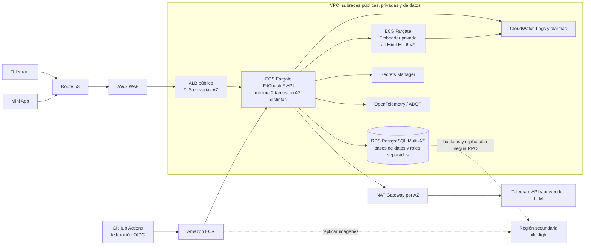

# Arquitectura AWS propuesta

Diseño de referencia para ejecutar FitCoachIA en AWS. Es una propuesta, no una descripción de
infraestructura desplegada. Los tamaños, costes, región y objetivos de recuperación deben
confirmarse con datos de carga y requisitos del servicio antes de implementarla.

## Objetivos y contexto

FitCoachIA es una aplicación FastAPI en contenedores. Recibe actualizaciones de Telegram por
webhook, sirve la Mini App, utiliza PostgreSQL para datos conversacionales y otro PostgreSQL con
pgVector para recuperar ejercicios. Un servicio privado genera embeddings; el proveedor LLM se
configura mediante una API compatible con OpenAI. El scheduler de avisos y encuestas forma parte
del proceso de la aplicación y coordina los jobs mediante PostgreSQL.

La propuesta prioriza alta disponibilidad dentro de una región, servicios administrados y una
recuperación regional de coste moderado. No cambia el proveedor LLM ni el modelo de embeddings.

## Topología

El diagrama editable está en [arquitectura-aws-diagrama.drawio](./arquitectura-aws-diagrama.drawio);
su guía de lectura, en [arquitectura-aws-diagrama.md](./arquitectura-aws-diagrama.md).

## Selección de servicios

| Necesidad | Servicio propuesto | Motivo y consideraciones |
|---|---|---|
| Entrada HTTP | Route 53, AWS Certificate Manager, AWS WAF y Application Load Balancer | DNS, TLS, filtrado y distribución a tareas sanas. Mantener una URL estable para Telegram y la Mini App. |
| API | ECS con Fargate, en subredes privadas | Reutiliza la imagen Docker y evita administrar hosts. Ejecutar al menos dos tareas en AZ diferentes y escalar con métricas de carga. |
| Embeddings | ECS Fargate privado | Mantiene el servicio y el modelo actuales, sin exponerlo públicamente. Dimensionar memoria para cargar el modelo. |
| Datos | Amazon RDS for PostgreSQL Multi-AZ | Servicio administrado, failover entre AZ, backups automáticos y recuperación a un punto en el tiempo. |
| Imágenes | Amazon ECR | Registro privado para imágenes versionadas y escaneadas antes del despliegue. |
| Secretos | AWS Secrets Manager | Evita incluir credenciales en imágenes, repositorios o definiciones de infraestructura. |
| Observabilidad | Amazon CloudWatch y OpenTelemetry/ADOT | Centraliza logs y alarmas; permite conservar la instrumentación OpenTelemetry existente. Grafana puede mantenerse si se desea conservar los dashboards actuales. |
| Infraestructura | Terraform | Versiona y revisa la red, IAM, servicios, bases de datos, alarmas y configuración de recuperación. |

### PostgreSQL conversacional y pgVector

Como primer paso de coste, alojar ambas bases de datos en una instancia RDS Multi-AZ, pero mantener
bases de datos, usuarios y permisos separados. El rol de recuperación del catálogo permanece de
solo lectura; la publicación de ejercicios utiliza el rol de escritura limitado. Así se conserva la
separación lógica sin asumir de entrada el coste de dos instancias Multi-AZ.

Esta opción comparte recursos y dominio de fallo. Si el catálogo requiere una carga, escalado,
aislamiento o ventana de mantenimiento distintos, mover pgVector a otra instancia RDS. Antes de
elegir motor y versión, verificar que la extensión pgvector y las operaciones del proyecto son
compatibles con la oferta administrada seleccionada. El corpus requiere embeddings de 384
dimensiones del modelo `sentence-transformers/all-MiniLM-L6-v2`; cambiar de modelo requiere
re-vectorizar el catálogo.

## Alta disponibilidad y recuperación

- **Dentro de la región:** ALB y ECS en varias AZ, con al menos dos tareas de API. Diseñar capacidad
  suficiente para soportar la carga necesaria tras perder una AZ y probar el comportamiento.
- **Base de datos:** RDS Multi-AZ cubre fallos de instancia/zona. Configurar backups y retención de
  acuerdo con los requisitos de negocio, y probar restauraciones.
- **Región secundaria:** empezar con *pilot light*: infraestructura reproducible, imágenes ECR
  replicadas y datos replicados o restaurables en la segunda región. Los datos de pgVector también
  deben incluirse en el plan de recuperación.
- **Objetivos iniciales para validar:** RPO de hasta 15 minutos y RTO de hasta 4 horas. No son
  garantías del diseño: deben comprobarse mediante un ejercicio de recuperación. Un *warm standby*
  puede reducir el RTO a cambio de mayor coste.
- **Dependencias externas:** Telegram y el proveedor LLM quedan fuera del dominio de disponibilidad
  de AWS. Su indisponibilidad debe tener tratamiento operativo y no debe causar que las tareas se
  consideren no saludables de forma continua.

La redundancia de AWS no garantiza por sí sola la disponibilidad extremo a extremo. Deben
verificarse capacidad tras perder una AZ, salud de las dependencias, failover de RDS y tiempos reales
de recuperación.

## Seguridad y privacidad

### Red e identidad

- Colocar ALB en subredes públicas; API y embedder en subredes privadas; RDS en subredes de datos
  sin acceso público.
- Permitir acceso a PostgreSQL solo desde el security group de la API. Permitir el puerto del
  embedder solo desde la API.
- Usar security groups con permisos mínimos y roles IAM separados para tareas ECS, ejecución,
  despliegue y operación.
- Conectar GitHub Actions a AWS mediante OIDC y permisos restringidos al repositorio, rama y
  acciones necesarias; no guardar claves AWS permanentes en GitHub.
- Usar Systems Manager para administración de instancias auxiliares, sin abrir SSH público.

### Datos y protección

- Cifrar RDS, backups, ECR, logs y secretos con KMS; usar TLS para tráfico público e interno cuando
  el servicio lo soporte.
- Recuperar secretos de Secrets Manager con el rol de tarea correspondiente y limitar acceso a
  cada secreto.
- Conservar la validación existente del secreto del webhook de Telegram. Usar WAF con reglas
  administradas y límites de solicitudes, ajustados para no bloquear tráfico legítimo.
- Habilitar CloudTrail y GuardDuty, y notificar hallazgos relevantes.
- Revisar retención y acceso de logs, trazas y dashboards. Minimizar identificadores de Telegram y
  no registrar prompts, perfiles ni mensajes de usuarios. Evaluar requisitos RGPD, residencia de
  datos y el tratamiento realizado por el proveedor LLM.

## Costes y optimización

No se proporciona una cifra mensual sin conocer región, concurrencia, almacenamiento, retención,
tráfico de red y consumo de tokens. Los costes fijos principales probablemente serán RDS Multi-AZ,
las tareas mínimas de Fargate y la salida de red.

1. Comenzar con una instancia RDS Multi-AZ y bases de datos/roles separados; separar instancias si
   las métricas o requisitos lo justifican.
2. Medir CPU y memoria de API y embedder; ajustar tamaños y escalar por carga. Revisar la memoria
   necesaria para el modelo de embeddings cargado.
3. NAT Gateway por AZ mejora la disponibilidad, pero tiene coste. Comparar el coste de endpoints
   VPC para ECR, S3, CloudWatch y Secrets Manager con el coste del tráfico NAT.
4. La API requiere salida a Internet para Telegram y el LLM. Confirmar rutas, DNS y políticas de
   salida, y limitar destinos donde sea viable.
5. Usar Fargate Spot para CI o trabajos interrumpibles, no para la capacidad mínima de producción
   ni para un componente cuya interrupción afecte a los jobs programados.
6. Ajustar retención de logs y trazas, alertas de presupuesto y detección de anomalías. No adquirir
   Savings Plans o reservas hasta tener un patrón de uso estable y medido.
7. Reducir redundancia en desarrollo, no en producción si esta debe cumplir los objetivos de
   disponibilidad establecidos.

## Despliegue y migración

1. Describir con Terraform VPC, subredes, security groups, IAM, ECR, ECS, RDS, secretos, DNS,
   alarmas y backups.
2. Crear bases de datos y validar versión de PostgreSQL, pgvector, extensiones y migraciones.
   Migrar con `pg_dump` y restauración si se acepta una ventana de mantenimiento; evaluar AWS DMS
   si se necesita reducirla.
3. Publicar una imagen inmutable en ECR y probarla primero en un entorno no productivo, usando un
   bot de Telegram distinto. Verificar webhook, Mini App, LLM, embeddings, catálogo y scheduler.
4. Migrar datos y validar conteos, integridad, permisos, consultas pgVector y restauración.
5. Desplegar con una actualización gradual de ECS, conservando la versión de imagen anterior.
   Mantener las migraciones de base de datos compatibles hacia atrás.
6. Cambiar el destino del tráfico y confirmar salud del ALB, webhook, respuestas de la API,
   entregas de Telegram y ejecución de jobs.
7. Retirar el entorno anterior cuando haya pasado el periodo de observación y no se necesite para
   rollback.

### Cambios operativos necesarios

- El contenedor actual ejecuta `alembic upgrade head` al arrancar. En ECS, ejecutar las migraciones
  como una tarea de despliegue única antes de actualizar el servicio; no hacer que cada réplica
  migre simultáneamente.
- El arranque actual registra el webhook de Telegram. Hacer esa operación una sola vez como paso
  de despliegue o tarea controlada, evitando que las réplicas compitan por registrar la misma
  configuración.
- El endpoint `/health` actual devuelve estado saludable sin comprobar dependencias. Definir una
  comprobación de readiness adecuada para el ALB, sin acoplarla a la disponibilidad del proveedor
  LLM.
- El scheduler corre dentro de cada proceso de aplicación. Su coordinación actual mediante
  PostgreSQL debe conservarse y probarse con varias tareas ECS; revisar la configuración para
  evitar duplicar efectos laterales al escalar.

## Rollback y validación

El rollback de aplicación consiste en volver a desplegar la imagen anterior. Las migraciones deben
ser compatibles con esa imagen; no depender de revertir automáticamente cambios de esquema
destructivos.

Antes de producción, probar:

- Pérdida de una tarea y de una AZ, incluyendo capacidad restante y salud de los targets del ALB.
- Failover Multi-AZ y conexiones de la aplicación tras el failover.
- Restauración de backup y activación de la región secundaria.
- Registro y entrega del webhook de Telegram, incluida la reversión de versión.
- Ejecución concurrente del scheduler con varias tareas.

Registrar los RPO y RTO realmente medidos y compararlos con los objetivos acordados.
