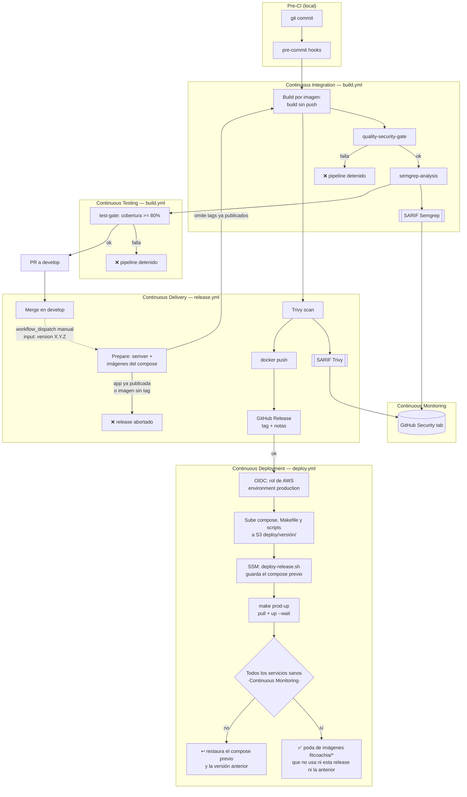
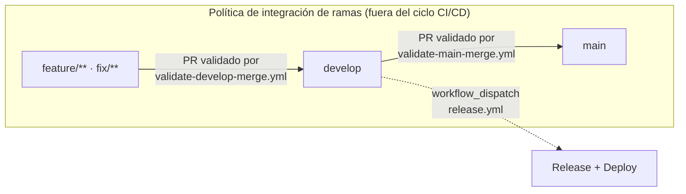

# Flujo CI/CD

Este documento describe el pipeline de integración, entrega y despliegue continuo de FitCoachIA:
qué dispara cada pieza, qué objetivo cumple dentro del ciclo y cómo fluye una ejecución de
principio a fin.

> Para cómo encajan el despliegue, el `Makefile` y los ficheros de entorno de cada entorno, ver
> [entornos-y-despliegue.md](entornos-y-despliegue.md). Para los comandos, [Makefile.md](Makefile.md).

## 1. Alcance

Cubre los workflows de GitHub Actions y las composite actions que forman el pipeline, más el hook
de pre-commit que actúa como primera barrera antes de llegar a CI. **No** cubre los workflows
`validate-develop-merge.yml` y `validate-main-merge.yml`: no compilan, testean ni despliegan nada,
solo validan el origen de un PR, por lo que se documentan aparte en el [Anexo A](#anexo-a--políticas-de-integración-de-ramas).

| Pieza | Ruta | Tipo |
|---|---|---|
| Pre-commit | [`.pre-commit-config.yaml`](../.pre-commit-config.yaml) | Hook local |
| Test and build project | [`.github/workflows/build.yml`](../.github/workflows/build.yml) | Workflow |
| Generate and deploy release | [`.github/workflows/release.yml`](../.github/workflows/release.yml) | Workflow |
| Deploy release | [`.github/workflows/deploy.yml`](../.github/workflows/deploy.yml) | Workflow (reusable) |
| Python setup custom | [`.github/actions/python-setup/action.yml`](../.github/actions/python-setup/action.yml) | Composite action |
| Quality assurance | [`.github/actions/quality-check/action.yml`](../.github/actions/quality-check/action.yml) | Composite action |

La frontera entre **Delivery** y **Deployment** está en el `workflow_dispatch` de `release.yml`:
build, escaneo y publicación del artefacto son automáticos, pero **liberar una versión es una
decisión humana** (quién dispara el workflow y con qué versión). Una vez lanzada, el despliegue en
el servidor es 100 % automático y encadenado.

## 2. El pipeline por fases

Cada fase de la metodología DevOps se corresponde con una pieza concreta del repo. Por cada
herramienta se indica su **objetivo** dentro del ciclo, no el comando exacto que ejecuta.

### 2.1 Pre-CI (shift-left local) — `.pre-commit-config.yaml`

**Dispara**: `git commit`. Primera barrera, antes de que el código salga del equipo del
desarrollador; su objetivo es abaratar el coste de un error (detectarlo en segundos en local, no
en minutos en CI).

| Herramienta | Objetivo |
|---|---|
| Hooks básicos (whitespace, EOF, YAML, merge conflicts, ficheros grandes, `no-commit-to-branch`) | Higiene mínima del repo; bloquea de raíz el commit directo a `main`/`develop`. |
| `gitleaks` | Evita que un secreto llegue a existir en el historial de Git. |
| `ruff` + `ruff-format` | Estilo y errores estáticos detectables sin ejecutar el código; feedback inmediato. |
| `bandit` | Primera pasada de SAST sobre `src/`: patrones inseguros conocidos (`eval`, `subprocess`, etc.). |
| `cfn-lint` | Valida la plantilla de CloudFormation (`infra/aws/ec2/*.cfn.yaml`) antes de crear o actualizar la pila; `check-yaml` la excluye porque no entiende las etiquetas `!Ref`/`!Sub`. |

### 2.2 Continuous Integration — `build.yml`

**Dispara**: `push` y `pull_request` sobre `feature/**`, `feat/**`, `fix/**`, `bugfix/**` (se
ignoran cambios que solo tocan documentación). Tres jobs encadenados por `needs`:
`quality-security-gate` → `semgrep-analysis` → `test-gate`.

> ⚠️ El filtro de `pull_request` se evalúa sobre la rama **base**: un PR `feature/x → develop` no
> vuelve a disparar este workflow, porque esos commits ya se validaron en el `push` a la rama de
> trabajo. Ver [Anexo B](#anexo-b--notas-de-estado).

**Job `quality-security-gate`** — repite y endurece lo que el pre-commit ya comprobó en local
(ahora bloqueante para todo el equipo, no solo para quien hizo el commit), y añade auditoría de
dependencias:

| Herramienta | Objetivo |
|---|---|
| `pip-audit` (antes de instalar) | Corta el pipeline si una dependencia a instalar tiene una vulnerabilidad `HIGH`/`CRITICAL`, antes de traer código potencialmente vulnerable al runner. |
| `ruff` | Lint bloqueante para todo el equipo. |
| `mypy` | Seguridad de tipos estática; detecta errores que los tests no siempre cubren. |
| `gitleaks` | Segunda barrera anti-secretos, por si el hook local se saltó (`--no-verify`). |
| `pip-audit` (tras instalar) | Segunda pasada, ya sobre el entorno realmente instalado. |
| `bandit` | SAST bloqueante sobre `src/fitcoach/`. |

**Job `semgrep-analysis`** — SAST complementario a `bandit`, con reglas más amplias
(`p/python` + `p/owasp-top-ten`) y capacidad de detectar patrones entre archivos. Analiza solo el
diff en PRs, no el repo completo. **No bloquea el merge** (`continue-on-error: true`): su ratio de
falsos positivos es mayor que el de `bandit`, así que su valor está en la trazabilidad continua de
hallazgos — sube el resultado en formato SARIF a la pestaña **Security** de GitHub — no en cortar
el flujo de trabajo del equipo.

### 2.3 Continuous Testing — `build.yml` (job `test-gate`)

Valida comportamiento funcional real (unitarios + integración) contra el mismo stack que se usaría
en local (app + Postgres vía Docker), para que el resultado en CI nunca diverja del de desarrollo.
Esa equivalencia no es una coincidencia: el job ejecuta **`make tests`**, el mismo target que se
usa en local. Gate: cobertura mínima del 80 % como proxy de calidad.

### 2.4 Continuous Delivery — `release.yml`

**Dispara**: `workflow_dispatch` manual con input `version` (`X.Y.Z`) — publicar una versión es una
decisión humana explícita. **Guardia**: solo se ejecuta si la rama es `develop` o `release/**`.

Objetivo general: convertir un commit en imágenes versionadas, escaneadas y trazables, y crear la
release solo cuando todas están publicadas.

Las imágenes que publica son las que `docker-compose.yml` construye (servicios con `build:`), todas
en el namespace `fitcoachia` de Docker Hub. Hoy son nueve: la app, el embedder, `pgvector` y las seis
de observabilidad. La app (`fitcoachia/fitcoach-app`) toma la versión de la release; el resto
llevan un **tag por componente fijado en el compose** (`fitcoachia/embedder:1.0.0`...), porque casi
nunca cambian y no tiene sentido republicarlas en cada release. Solo `fitcoach-app` es privada; el
resto son públicas.

| Job / paso | Objetivo |
|---|---|
| `Prepare`: validar formato semver | Evita releases ambiguos. |
| `Prepare`: listar imágenes | Lee el compose con `docker compose config --no-interpolate` (sin resolver variables de entorno) y obtiene imagen, contexto y Dockerfile de cada servicio construible. Falla si alguna imagen no tiene tag fijo. |
| `Prepare`: comprobar Docker Hub | Si la imagen de la app ya existe con esa versión, aborta (no se sobrescribe una release). Si una imagen de componente ya existe con su tag, se omite: no se reconstruye ni se republica. El resumen del job lista qué se publica y qué se omite. |
| `Build` (una ejecución por imagen pendiente, en paralelo) | Construye sin publicar (`push: false`, caché de buildx en GitHub Actions por imagen), escanea y publica. Un fallo en una imagen no cancela las demás. |
| **Trivy** (escaneo de cada imagen) | Equivalente a Semgrep pero sobre el artefacto construido (paquetes de SO + librerías del contenedor), no sobre el código fuente. Informativo, no bloquea el release; sube un SARIF por imagen (categoría `trivy-<servicio>`) a la misma pestaña **Security** de GitHub que Semgrep. |
| `docker push` | Cada imagen llega al registro después de escanearse. |
| `Release`: **GitHub Release** (tag + notas autogeneradas) | Solo se crea cuando todas las imágenes están publicadas, así una release nunca apunta a imágenes que no existen. |
| `Deploy` | Llama a `deploy.yml` con la versión. |

Para cambiar un componente (por ejemplo, una regla de alerta, que va dentro de la imagen de
Grafana), hay que **subir su tag en `docker-compose.yml`** en el mismo cambio. Si no, la siguiente
release ve el tag ya publicado, lo omite y el cambio no llega a producción.

Si una imagen falla en `Build`, se relanza con **Re-run failed jobs**: repite solo las imágenes que
fallaron y luego crea la release. Relanzar el workflow entero con la misma versión no sirve si la
imagen de la app ya se publicó (`Prepare` aborta); en ese caso hay que usar otra versión.

> Semgrep y Trivy son dos escáneres distintos en dos momentos distintos del ciclo — código fuente
> en CI, imágenes construidas en el release — pero ambos convergen en la misma pestaña Security de
> GitHub. El único fichero que se publica fuera de esa pestaña es la propia **GitHub Release**.

### 2.5 Continuous Deployment — `deploy.yml`

**Dispara**: automáticamente al terminar `Release`, o de forma independiente vía
`workflow_dispatch` para redesplegar una versión ya publicada. Despliega en la instancia EC2 de
producción ([despliegue-aws-ec2.md](despliegue-aws-ec2.md)) **sin SSH y sin clonar el repositorio**:

1. Hace checkout del **tag de la versión**, así el compose y el `Makefile` que se despliegan son los
   de esa release, con sus tags de imagen.
2. Asume por **OIDC** el rol de AWS que crea la plantilla. Ese rol solo acepta tokens del
   environment `production` de este repositorio, así que el job declara `environment: production`
   y no hay claves de AWS guardadas en GitHub.
3. Lee de la pila de CloudFormation el id de la instancia y el bucket.
4. Sube `docker-compose.yml`, `Makefile`, `backup-postgres.sh` y `deploy-release.sh` a
   `s3://<bucket>/deploy/<versión>/`.
5. Lanza por **SSM** (`AWS-RunShellScript`, como root) un comando que los descarga y ejecuta
   [`deploy-release.sh`](../infra/aws/ec2/deploy-release.sh), y espera el resultado con un bucle
   propio (`aws ssm wait command-executed` se rinde a los ~100 s). La salida del script aparece en
   el log del job.

`deploy-release.sh`, en `/opt/fitcoachia`:

1. Anota la versión en servicio (tag de la imagen de `fitcoach-ia`) y guarda el compose actual como
   `docker-compose.prev.yml`.
2. Instala los tres ficheros de la release.
3. `make prod-up` con `VERSION=<versión>`: `pull` de todas las imágenes y `up --wait`, que espera a
   que todos los servicios estén sanos (hasta 900 s).
4. Si falla, restaura `docker-compose.prev.yml` y lanza `make prod-up` con la versión anterior, y el
   workflow termina en rojo. Si no había versión anterior, el servicio queda como esté.
5. Si va bien, borra las imágenes `fitcoachia/*` que no usan ni el compose nuevo ni el anterior.

Patrón: **recreate verificado con rollback**. Compose solo recrea los servicios cuya imagen o
configuración cambian; los demás siguen en marcha. Mientras se recrea la app hay una ventana breve
sin servicio: el proxy devuelve 502 y Telegram reintenta los updates, así que no se pierden mensajes.
Solo se puede desplegar una versión publicada con este esquema: las anteriores no tienen
`deploy-release.sh` en su tag.

Un despliegue no se cancela por otro: `concurrency` los pone en cola.

**Prerrequisitos que CI nunca provee**, deben existir ya en la instancia: `/opt/fitcoachia/.env`
(`600 root`) y el login en Docker Hub de root, porque `fitcoachia/fitcoach-app` es privada. Ver
[despliegue-aws-ec2.md](despliegue-aws-ec2.md).

### 2.6 Continuous Monitoring

No hay un job dedicado; el monitoreo continuo se apoya en dos señales que ya generan las fases
anteriores:

- **`healthcheck` del contenedor** sobre `/health` — decide el resultado del despliegue (y su
  rollback), y después sigue sondeando cada 5 min como señal de salud continua en producción.
- **Pestaña Security de GitHub** — acumula los SARIF de Semgrep (CI, código fuente) y Trivy
  (release, imágenes construidas) como registro continuo de hallazgos, independiente de si bloquearon
  o no el pipeline que los generó.

## 3. Diagramas

### 3.1 Flujo global



### 3.2 Secuencia de despliegue

```mermaid
sequenceDiagram
    participant R as Runner (GitHub Actions)
    participant A as AWS (STS, CloudFormation, S3)
    participant S as Instancia (SSM, root)

    Note over R,S: Continuous Deployment — deploy.yml
    R->>A: AssumeRoleWithWebIdentity (OIDC, environment production)
    R->>A: DescribeStacks: InstanceId y BackupBucketName
    R->>A: s3 cp compose, Makefile, backup-postgres.sh, deploy-release.sh
    R->>S: ssm send-command (AWS-RunShellScript)
    activate S
    S->>A: s3 cp deploy/<versión>/
    S->>S: 1/5 Contexto y .env
    S->>S: 2/5 Versión en servicio y docker-compose.prev.yml
    S->>S: 3/5 Instalar los ficheros en /opt/fitcoachia
    S->>S: 4/5 make prod-up (pull + up --wait)
    Note right of S: Continuous Monitoring
    alt todos los servicios sanos
        S->>S: 5/5 Podar imágenes fitcoachia/* sin uso
    else falla
        S->>S: Volcar estado y últimas 50 líneas de log
        S->>S: Restaurar docker-compose.prev.yml\nmake prod-up con la versión anterior
    end
    deactivate S
    loop cada 15 s
        R->>S: get-command-invocation
    end
    S-->>R: salida del script; Success o fallo (workflow en rojo)
```

El detalle del despliegue y de los targets del `Makefile` está en
[entornos-y-despliegue.md](entornos-y-despliegue.md).

## 4. Gates, secretos y artefactos

### Gates

| Gate | Dónde | Bloquea o informa |
|---|---|---|
| `pip-audit` (OSV, HIGH/CRITICAL) | `python-setup`, antes de instalar | Bloquea |
| `ruff` / `mypy` / `gitleaks` / `pip-audit` / `bandit` | `quality-check` | Bloquea |
| Semgrep (`p/python`, `p/owasp-top-ten`) | `build.yml` → `semgrep-analysis` | Informa (SARIF) |
| Cobertura de tests ≥ 80 % | `build.yml` → `test-gate` | Bloquea |
| Formato semver de la versión | `release.yml`, `deploy.yml` | Bloquea |
| La imagen de la app no debe existir ya en el registro con esa versión | `release.yml` → `Prepare` | Bloquea |
| Toda imagen construible del compose tiene tag fijo | `release.yml` → `Prepare` | Bloquea |
| Trivy (cada imagen, HIGH/CRITICAL) | `release.yml` → `Build` | Informa (SARIF) |
| Origen de release: `develop` o `release/*` | `release.yml` (`if:`) | Bloquea |
| Todos los servicios sanos tras `make prod-up` (`up --wait`) | `deploy.yml` → `deploy-release.sh` | Bloquea **y revierte** a la versión anterior |

### Artefactos publicados

| Artefacto | Generado por | Dónde se ve |
|---|---|---|
| SARIF Semgrep | `build.yml` → `semgrep-analysis` | Pestaña *Security* (code scanning) |
| SARIF Trivy (uno por imagen) | `release.yml` → `Build` | Pestaña *Security* (code scanning) |
| GitHub Release (tag + notas) | `release.yml` | Pestaña *Releases* |
| Imágenes Docker versionadas (`fitcoachia/*`) | `release.yml` → `Build` (`docker push`) | Registro Docker Hub |

### Secretos

| Secreto | Usado en |
|---|---|
| `DOCKER_USER`, `DOCKER_PASSWORD` | `release.yml` (login en Docker Hub) |
| `AWS_DEPLOY_ROLE_ARN` | `deploy.yml` (rol de AWS que asume por OIDC; salida de la plantilla de EC2) |
| `AWS_REGION` | `deploy.yml` (región de la pila) |
| `AWS_STACK_NAME` | `deploy.yml` (nombre de la pila de CloudFormation) |

`release.yml` pasa los secretos a `deploy.yml` con `secrets: inherit`, y el job de despliegue
también puede leerlos del environment `production`. Ningún workflow expone sus valores en logs.
Ya no se usan `SERVER_HOST`, `SERVER_USER`, `SERVER_PKEY`, `ENV_FILE_PATH` ni `DOCKER_IMAGE_NAME`, y
se pueden borrar.

---

## Anexo A — Políticas de integración de ramas

> Esta sección queda fuera del ciclo CI/CD descrito arriba: estos workflows no compilan, no
> testean ni despliegan nada. Su único propósito es validar **desde qué rama** se puede abrir un PR
> contra `develop` o `main`, como política de integración (equivalente a una regla de branch
> protection).

- **[`validate-develop-merge.yml`](../.github/workflows/validate-develop-merge.yml)** — en cada PR
  contra `develop`, comprueba que la rama de origen (`head_ref`) empiece por `feature/` o `fix/`;
  si no, falla el check y el PR queda bloqueado.
- **[`validate-main-merge.yml`](../.github/workflows/validate-main-merge.yml)** — en cada PR contra
  `main`, exige que la rama de origen sea exactamente `develop`.

Ambas se apoyan en el hook `no-commit-to-branch` de pre-commit (`main`, `develop`), que impide de
raíz el commit directo a esas ramas en local.



## Anexo B — Notas de estado

Observaciones sobre el estado actual del pipeline que conviene tener presentes al interpretar una
ejecución o al modificar los workflows:

| Observación | Detalle |
|---|---|
| PR a `develop` no re-ejecuta `build.yml` | El filtro `pull_request.branches` evalúa la rama **base**, no la de origen; la validación de esos commits ya ocurrió en el `push` a la rama de trabajo. |
| `bugfix/**` se valida pero no se puede fusionar | `build.yml` dispara sobre `bugfix/**`, pero `validate-develop-merge.yml` solo admite `feature/`, `feat/` y `fix/`: un PR desde `bugfix/**` a `develop` queda bloqueado pese a haber pasado CI. |
| Versión del proyecto desincronizada | `pyproject.toml` declara `0.1.0` mientras los tags Git ya están en `0.4.2`; no hay bump automático de versión. |
