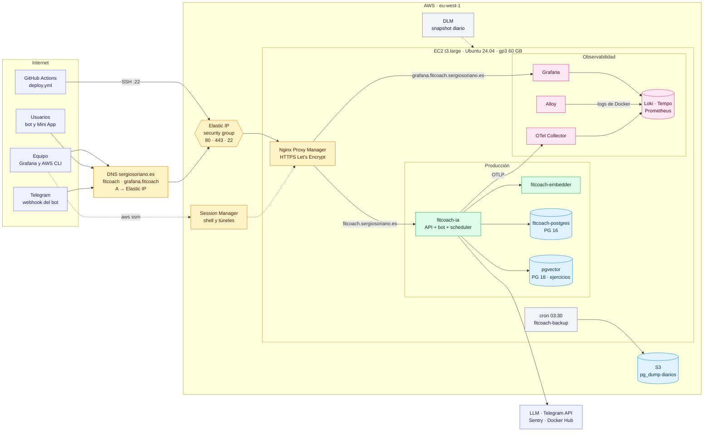

# Despliegue en AWS sobre una única instancia EC2

Variante de despliegue en AWS que **reproduce el servidor actual** en una instancia EC2 con los
mínimos cambios en el repositorio. Los Compose, el `Makefile`, el `deploy.yml` por SSH, los ficheros
`/etc/fitcoachia/<entorno>/.env.<entorno>`, Nginx Proxy Manager y el stack de observabilidad del
proyecto (Grafana, Loki, Tempo, Prometheus, OTel Collector y Alloy) se usan igual que hoy; lo único
que cambia es la máquina en la que corren. La infraestructura de AWS se crea con una plantilla de
**CloudFormation**: [`infra/aws/ec2/fitcoach-ec2.cfn.yaml`](../infra/aws/ec2/fitcoach-ec2.cfn.yaml).

No se usan servicios de observabilidad de AWS (CloudWatch Logs, X-Ray, Managed Grafana): trazas,
logs y métricas siguen en el stack de [observabilidad.md](observabilidad.md). Para el contexto
general ver [entornos-y-despliegue.md](entornos-y-despliegue.md) y [ci-cd.md](ci-cd.md).

El documento tiene tres partes:

- **Visión general** (secciones 1 y 2): qué se monta y qué cambia.
- **Puesta en marcha, paso a paso** (secciones 3 a 11): en el orden en que se hace, la primera vez.
- **Operación y referencia** (secciones 12 a 14): backups, actualizaciones, coste y decisiones.

---

## 1. Visión general

### 1.1 Qué cambia respecto al servidor actual

| Pieza | Hoy (servidor actual) | En AWS | ¿Cambia algo en el repo? |
| --- | --- | --- | --- |
| Máquina | Servidor propio | EC2 `t3.large` (2 vCPU, 8 GB, x86_64), Ubuntu 24.04 LTS | No |
| Infraestructura | Manual | Plantilla CloudFormation | Fichero nuevo |
| Contenedores | `docker-compose.yml` + Compose de pgVector | Los mismos | No |
| Observabilidad | `infra/observability/compose.yml` | El mismo, en la misma instancia | No |
| Proxy y TLS | Nginx Proxy Manager en `proxy-network` | El mismo, con [nginx-proxy-manager.compose.yml](../infra/aws/ec2/nginx-proxy-manager.compose.yml) | Fichero nuevo de referencia |
| Secretos | `/etc/fitcoachia/prod/.env.prod` (root) e `infra/*/.env*` | Igual | No |
| Despliegue | `deploy.yml`: SSH + `sudo make prod-up` | Igual; solo cambian los secretos `SERVER_*` de GitHub | No |
| Dominio | `dev.fitcoach.sergiosoriano.es`, `grafana.fitcoach.sergiosoriano.es` | Nuevo `fitcoach.sergiosoriano.es` para producción y `grafana.fitcoach` a la Elastic IP | No |
| Datos | — | Producción arranca con las bases vacías: no se migra nada | No |
| Backups | — | Snapshots EBS diarios (DLM) + `pg_dump` nocturno a S3 | Script nuevo |

Se elige **x86_64** (`t3`) y no Graviton (`t4g`) porque las imágenes actuales solo se publican para
`amd64`. Pasar a ARM exige builds multiarquitectura y queda como mejora posterior.

Coste orientativo en `eu-west-1`, bajo demanda: **≈ 77 USD/mes** solo producción con observabilidad
(≈ 54 $ con un Savings Plan de 1 año). Detalle en la [sección 13](#13-coste).

### 1.2 Diagrama



Las líneas discontinuas son acceso de administración o tareas de AWS. Grafana lee además
`fitcoach-postgres` para los dashboards de negocio. Las redes de Docker son las de hoy:
`proxy-network` une Nginx Proxy Manager con la API y Grafana; `fitcoach-prod-internal` une la API con
el embedder, los dos Postgres y el collector, y también llega a Grafana; `observability` es la red
interna del stack de observabilidad.

### 1.3 Qué crea la plantilla

| Recurso | Para qué |
| --- | --- |
| Security group | 443 y 80 desde internet (IPv4 e IPv6); 22 desde `SshIngressCidr` (para `deploy.yml`) |
| Instancia EC2 | Ubuntu 24.04, `t3.large` por defecto, crédito *unlimited*, IMDSv2 obligatorio, protección contra terminación, disco gp3 cifrado de 60 GB que **no** se borra si se termina la instancia |
| Elastic IP | IP fija para el DNS y para el secreto `SERVER_HOST`; se reasocia sola si la instancia se sustituye |
| Rol de instancia | Session Manager (shell y túneles sin abrir puertos) y escritura en `postgres/` del bucket de backups |
| Bucket S3 | Backups de Postgres, cifrado, sin acceso público, borra los volcados a los `BackupRetentionDays` días. Se conserva si se borra la pila |
| Política DLM | Snapshot diario de la instancia a las 03:00 UTC, conserva `SnapshotRetentionCount` |

En el primer arranque, el *user data* de la instancia la deja como el servidor actual:

1. Docker Engine (≥ 25, necesario por `start_interval` de los healthchecks), el plugin Compose,
   `make`, `git` y la AWS CLI.
2. Rotación de logs de Docker (`json-file`, 3 × 10 MB por contenedor). Alloy los sigue leyendo por
   la API de Docker.
3. 2 GB de swap.
4. Usuario de despliegue en el grupo `docker`, con la clave pública de GitHub Actions y la regla
   `sudoers` que exige `deploy.yml` ([how-to.md](how-to.md#desplegar-producción)).
5. `/etc/fitcoachia/prod` y `/etc/fitcoachia/dev` propiedad de root con permisos `700`.
6. Las redes `proxy-network`, `fitcoach-prod-internal` y `fitcoach-dev-internal` (el Compose de
   observabilidad exige las dos internas aunque dev no corra aquí).
7. El repositorio en `/opt/fitcoachia` (rama o tag `RepositoryRef`), y una copia de
   `docker-compose.yml` y `Makefile` en el *home* del usuario de despliegue, que es donde
   `deploy.yml` los sobrescribe.
8. El backup nocturno (`/etc/cron.d/fitcoach-backup`) y Nginx Proxy Manager arrancado.

No arranca la app, pgVector ni la observabilidad: necesitan ficheros de entorno con secretos, que no
deben pasar por CloudFormation (quedarían visibles en el *user data*). Eso se hace a mano en las
secciones 8 a 10.

---

## 2. Hoja de ruta

Todos los pasos de la puesta en marcha, en orden. Los que dependen de otra persona van marcados
para pedirlos con tiempo.

| # | Paso | Quién | Dónde | Sección |
| --- | --- | --- | --- | --- |
| 1 | Preparar el equipo: AWS CLI, plugin de Session Manager, perfil SSO | Cada integrante | Su equipo | [3](#3-preparar-el-equipo) |
| 2 | Generar la clave de despliegue y crear la pila | Administrador de AWS | Su equipo | [4](#4-crear-la-pila) |
| 3 | Crear el registro DNS de `fitcoach.sergiosoriano.es` | **Quien gestiona `sergiosoriano.es`** | Su proveedor de DNS | [5](#5-pedir-el-dns) |
| 4 | Dar acceso al resto del equipo | Administrador de AWS | IAM Identity Center | [6](#6-acceso-del-equipo) |
| 5 | Actualizar el repositorio y copiar los ficheros de entorno | Quien despliega | Instancia | [7](#7-configurar-la-instancia) |
| 6 | Crear las dos reglas del proxy y su certificado | Quien despliega | Panel de NPM | [8](#8-reglas-del-proxy-en-nginx-proxy-manager) |
| 7 | Arrancar observabilidad, pgVector y la aplicación | Quien despliega | Instancia | [9](#9-arrancar-los-servicios) |
| 8 | Mover `grafana.fitcoach`, revisar BotFather y cambiar los secretos de GitHub | **DNS y administrador del repositorio** | DNS, BotFather, GitHub | [10](#10-cerrar-la-puesta-en-marcha) |
| 9 | Comprobar que todo funciona | Quien despliega | Telegram, Grafana, S3 | [11](#11-comprobar) |

---

## 3. Preparar el equipo

Una vez por persona, en el equipo desde el que se trabaja:

- **AWS CLI v2** (`aws --version`). La v1 no admite SSO.
- **Plugin de Session Manager** para la AWS CLI, necesario para `aws ssm start-session` (instalador
  oficial de AWS para Windows, macOS o Linux).
- **Perfil SSO** de su usuario de IAM Identity Center, creado con `aws configure sso`. Quien crea la
  pila necesita permisos de administrador (la pila crea roles de IAM); nunca el usuario root. El
  resto, el *permission set* de la [sección 6](#6-acceso-del-equipo). La sesión caduca a las pocas
  horas y se renueva con `aws sso login`.

Los comandos van en dos versiones, cada una con su etiqueta: **PowerShell (Windows)** y **bash
(Linux, macOS, WSL)**; los que sirven igual en las dos se indican como tales, y los que se ejecutan
dentro de la instancia, como **bash (en la instancia)**. Todos usan explícitamente el perfil de la
AWS CLI, aquí `fitcoach`, y la región `eu-west-1` (Irlanda; `eu-south-2`, Madrid, también vale). Si
el perfil se llama de otra forma, `aws configure list-profiles` lo muestra.

Al empezar cada sesión de trabajo, definir las variables e iniciar sesión. `$InstanceId` /
`INSTANCE_ID` sale de las salidas de la pila ([sección 4.4](#44-después-de-crearla)): hasta crearla
se deja vacía.

**PowerShell (Windows):**

```powershell
$AwsProfile = "fitcoach"
$Region = "eu-west-1"
$InstanceId = "i-xxxxxxxxxxxxxxxxx"
aws sso login --profile $AwsProfile
aws sts get-caller-identity --profile $AwsProfile   # debe devolver la cuenta y el rol
```

**bash (Linux, macOS, WSL):**

```bash
AWS_PROFILE_NAME=fitcoach
REGION=eu-west-1
INSTANCE_ID=i-xxxxxxxxxxxxxxxxx
aws sso login --profile "$AWS_PROFILE_NAME"
aws sts get-caller-identity --profile "$AWS_PROFILE_NAME"
```

Las variables de PowerShell (`$AwsProfile`, `$Region`, `$PubKey`, `$Ami`...) son variables normales de
la sesión: no llevan `$env:`, que solo se usa para variables de entorno
([about_Variables](https://learn.microsoft.com/es-es/powershell/module/microsoft.powershell.core/about/about_variables),
[about_Environment_Variables](https://learn.microsoft.com/es-es/powershell/module/microsoft.powershell.core/about/about_environment_variables)).
Funcionan porque PowerShell sustituye su valor en el argumento antes de lanzar `aws`. Duran lo que
dura la ventana, así que los bloques se ejecutan en orden en la misma.

---

## 4. Crear la pila

Lo hace una vez un administrador de AWS, desde la raíz del repositorio.

### 4.1 Clave SSH de despliegue

La instancia se crea con la clave pública que se le pase en `DeploySshPublicKey`, y la escribe en el
`authorized_keys` del usuario de despliegue al arrancar. Es la clave que usará `deploy.yml`: su parte
privada acabará en el secreto `SERVER_PKEY` de GitHub. Se genera una pareja nueva, sin contraseña
(GitHub Actions no puede teclearla):

**PowerShell (Windows):**

```powershell
New-Item -ItemType Directory -Force $HOME\.ssh | Out-Null
ssh-keygen -t ed25519 -f $HOME\.ssh\fitcoach-deploy -C github-actions-deploy   # Enter dos veces
$PubKey = (Get-Content $HOME\.ssh\fitcoach-deploy.pub -Raw).Trim()
```

**bash (Linux, macOS, WSL):**

```bash
ssh-keygen -t ed25519 -f ~/.ssh/fitcoach-deploy -C github-actions-deploy -N ''
PUBKEY=$(cat ~/.ssh/fitcoach-deploy.pub)
```

- La clave privada (`fitcoach-deploy`, sin `.pub`) se entrega al administrador del repositorio por un
  canal seguro, nunca por chat o correo sin cifrar, y la guarda en `SERVER_PKEY` al final de la
  puesta en marcha ([sección 10](#10-cerrar-la-puesta-en-marcha)). Hasta entonces `deploy.yml` sigue
  desplegando en el servidor actual con la clave de siempre.
- Esta clave es solo para `deploy.yml`: las personas entran con su propio usuario
  ([sección 6](#6-acceso-del-equipo)).

### 4.2 AMI, VPC y subred

**PowerShell (Windows):**

```powershell
$Ami = aws ssm get-parameter --profile $AwsProfile --region $Region `
  --name /aws/service/canonical/ubuntu/server/24.04/stable/current/amd64/hvm/ebs-gp3/ami-id `
  --query Parameter.Value --output text
$VpcId = aws ec2 describe-vpcs --profile $AwsProfile --region $Region `
  --filters "Name=isDefault,Values=true" --query "Vpcs[0].VpcId" --output text
aws ec2 describe-subnets --profile $AwsProfile --region $Region `
  --filters "Name=vpc-id,Values=$VpcId" --query "Subnets[].[SubnetId,AvailabilityZone]" --output table
$SubnetId = "subnet-xxxxxxxx"   # una de la tabla anterior
```

**bash (Linux, macOS, WSL):**

```bash
AMI=$(aws ssm get-parameter --profile "$AWS_PROFILE_NAME" --region "$REGION" \
  --name /aws/service/canonical/ubuntu/server/24.04/stable/current/amd64/hvm/ebs-gp3/ami-id \
  --query Parameter.Value --output text)
VPC_ID=$(aws ec2 describe-vpcs --profile "$AWS_PROFILE_NAME" --region "$REGION" \
  --filters Name=isDefault,Values=true --query 'Vpcs[0].VpcId' --output text)
aws ec2 describe-subnets --profile "$AWS_PROFILE_NAME" --region "$REGION" \
  --filters "Name=vpc-id,Values=$VPC_ID" --query 'Subnets[].[SubnetId,AvailabilityZone]' --output table
SUBNET_ID=subnet-xxxxxxxx   # una de la tabla anterior
```

La AMI queda fijada como parámetro de la pila y no se resuelve sola: así una actualización no
sustituye la instancia por sorpresa ([sección 12.2](#122-actualizar-la-pila)).

### 4.3 Crear el change set, revisarlo y ejecutarlo

`RepositoryRef` es la rama o el tag que la instancia clona en `/opt/fitcoachia`. Debe contener
`infra/aws/ec2/`: si no, el arranque falla al no encontrar el script de backup. Mientras esta carpeta
no esté en `develop` (el valor por defecto), usar `feat/cloud-architecture`.

`--no-execute-changeset` prepara los cambios sin aplicarlos, para revisarlos antes:

**PowerShell (Windows):**

```powershell
aws cloudformation deploy --profile $AwsProfile --region $Region `
  --stack-name fitcoach-prod `
  --template-file infra/aws/ec2/fitcoach-ec2.cfn.yaml `
  --capabilities CAPABILITY_IAM `
  --no-execute-changeset `
  --parameter-overrides "VpcId=$VpcId" "SubnetId=$SubnetId" "ImageId=$Ami" `
    "DeploySshPublicKey=$PubKey" "RepositoryRef=feat/cloud-architecture"
```

**bash (Linux, macOS, WSL):**

```bash
aws cloudformation deploy --profile "$AWS_PROFILE_NAME" --region "$REGION" \
  --stack-name fitcoach-prod \
  --template-file infra/aws/ec2/fitcoach-ec2.cfn.yaml \
  --capabilities CAPABILITY_IAM \
  --no-execute-changeset \
  --parameter-overrides "VpcId=$VPC_ID" "SubnetId=$SUBNET_ID" "ImageId=$AMI" \
    "DeploySshPublicKey=$PUBKEY" "RepositoryRef=feat/cloud-architecture"
```

El comando termina imprimiendo el ARN del change set. Para revisarlo, ejecutarlo y esperar a que
termine (cada comando en una línea):

**PowerShell y bash (iguales):**

```shell
aws cloudformation describe-change-set --profile fitcoach --region eu-west-1 --change-set-name <arn-del-change-set> --query "Changes[].ResourceChange.[Action,LogicalResourceId,Replacement]" --output table
aws cloudformation execute-change-set --profile fitcoach --region eu-west-1 --change-set-name <arn-del-change-set>
aws cloudformation wait stack-create-complete --profile fitcoach --region eu-west-1 --stack-name fitcoach-prod
```

También se puede revisar y ejecutar desde la consola de CloudFormation (pestaña *Change sets*).

### 4.4 Después de crearla

Activar la protección contra borrado y ver las salidas de la pila:

**PowerShell y bash (iguales):**

```shell
aws cloudformation update-termination-protection --profile fitcoach --region eu-west-1 --enable-termination-protection --stack-name fitcoach-prod
aws cloudformation describe-stacks --profile fitcoach --region eu-west-1 --stack-name fitcoach-prod --query "Stacks[0].Outputs" --output table
```

Apuntar dos salidas, que se usan en el resto del documento:

- `InstanceId`: el valor de `$InstanceId` / `INSTANCE_ID` ([sección 3](#3-preparar-el-equipo)).
- `PublicIp`: la Elastic IP, para el DNS ([sección 5](#5-pedir-el-dns)) y `SERVER_HOST`.

---

## 5. Pedir el DNS

Producción usa `fitcoach.sergiosoriano.es`, sin etiqueta de entorno; desarrollo sigue en
`dev.fitcoach.sergiosoriano.es`. No se registra ningún dominio nuevo: es un nombre más de la zona
`sergiosoriano.es`, y lo crea quien gestiona esa zona en su proveedor de DNS actual. Conviene pedirlo
en cuanto exista la pila, porque Nginx Proxy Manager lo necesita para sacar el certificado
([sección 8](#8-reglas-del-proxy-en-nginx-proxy-manager)).

| Nombre | Tipo | Valor | TTL | Cuándo |
| --- | --- | --- | --- | --- |
| `fitcoach` | `A` | Elastic IP (`PublicIp`) | 300 | En cuanto exista la pila |
| `grafana.fitcoach` | `A` | Elastic IP (`PublicIp`) | 60 | Al final ([sección 10](#10-cerrar-la-puesta-en-marcha)) |
| `dev.fitcoach` | — | Sin cambios | — | — |

Pedirle también que compruebe:

- Que `fitcoach` no tenga ya un `CNAME` ni un `AAAA`. Un `AAAA` haría fallar a Let's Encrypt, porque la
  instancia no tiene IPv6.
- Que, si la zona tiene registros `CAA`, permitan `letsencrypt.org`.

Comprobar que ya resuelve a la Elastic IP:

**PowerShell (Windows):**

```powershell
Resolve-DnsName fitcoach.sergiosoriano.es -Type A
```

**bash (Linux, macOS, WSL):**

```bash
dig +short fitcoach.sergiosoriano.es A
```

---

## 6. Acceso del equipo

Cada integrante entra en la instancia **con su propio usuario de AWS a través de Session Manager**,
sin claves SSH compartidas y sin usar el puerto 22 (que queda solo para `deploy.yml`). La plantilla ya
da a la instancia el permiso de Session Manager.

- Cada sesión queda registrada a nombre de quien la abre.
- No hay claves de equipo que guardar ni rotar.
- Quitar el acceso a alguien es desactivar su usuario en IAM Identity Center.

No se debe repartir una clave común ni la clave de `deploy.yml`: no se sabría quién hace qué y, si
alguien deja el proyecto, habría que cambiarla para todos.

### 6.1 Usuarios en IAM Identity Center (un administrador, una vez)

1. En IAM Identity Center, crear un usuario por integrante (o un grupo `fitcoach` con los cuatro).
2. Asignarles la cuenta de AWS con un *permission set*:
   - `AdministratorAccess` para quien vaya a crear o actualizar la pila.
   - Para quien solo necesita entrar en la máquina, un *permission set* propio (p. ej.
     `FitCoachInstanceAccess`) con esta política en línea, sustituyendo `<cuenta>` e `<instance-id>`:

```json
{
  "Version": "2012-10-17",
  "Statement": [
    {
      "Sid": "StartSessionOnFitCoachInstance",
      "Effect": "Allow",
      "Action": "ssm:StartSession",
      "Resource": [
        "arn:aws:ec2:eu-west-1:<cuenta>:instance/<instance-id>",
        "arn:aws:ssm:eu-west-1::document/AWS-StartSSHSession",
        "arn:aws:ssm:eu-west-1::document/AWS-StartPortForwardingSession",
        "arn:aws:ssm:eu-west-1:<cuenta>:document/SSM-SessionManagerRunShell"
      ]
    },
    {
      "Sid": "ManageOwnSessions",
      "Effect": "Allow",
      "Action": ["ssm:TerminateSession", "ssm:ResumeSession"],
      "Resource": "arn:aws:ssm:*:*:session/*"
    },
    {
      "Sid": "TemporarySshKey",
      "Effect": "Allow",
      "Action": "ec2-instance-connect:SendSSHPublicKey",
      "Resource": "arn:aws:ec2:eu-west-1:<cuenta>:instance/<instance-id>",
      "Condition": { "StringEquals": { "ec2:osuser": "ubuntu" } }
    },
    {
      "Sid": "Discover",
      "Effect": "Allow",
      "Action": [
        "ec2:DescribeInstances",
        "ssm:DescribeInstanceInformation",
        "ssm:DescribeSessions",
        "ssm:GetConnectionStatus"
      ],
      "Resource": "*"
    }
  ]
}
```

### 6.2 Entrar en la instancia

Con las variables de la [sección 3](#3-preparar-el-equipo) ya definidas:

**PowerShell (Windows):**

```powershell
aws ssm start-session --profile $AwsProfile --region eu-west-1 --target $InstanceId
```

**bash (Linux, macOS, WSL):**

```bash
aws ssm start-session --profile "$AWS_PROFILE_NAME" --region eu-west-1 --target "$INSTANCE_ID"
```

Se entra como `ssm-user`, que tiene `sudo`. Para trabajar con más comodidad: `sudo -iu ubuntu` o
`bash -l`. Ojo: el usuario de despliegue (`fitcoach` por defecto) es otro, y su *home* es
`/home/fitcoach`.

### 6.3 Túneles a paneles internos

Los paneles de administración no se publican en internet. Se abre un túnel por Session Manager, se
deja la ventana abierta mientras se usa y el panel queda en `http://localhost:<puerto-local>`:

**PowerShell y bash (iguales):**

```shell
aws ssm start-session --profile fitcoach --region eu-west-1 --target <instance-id> --document-name AWS-StartPortForwardingSession --parameters "portNumber=81,localPortNumber=8081"
```

| Panel | `portNumber` | Ejemplo de `localPortNumber` |
| --- | --- | --- |
| Nginx Proxy Manager | `81` | `8081` |
| pgAdmin de pgVector | `PGADMIN_PORT` de `infra/vector-db/.env.prod` | `8010` |

En PowerShell, las comillas de `--parameters` son obligatorias: sin ellas la coma parte el argumento
en dos.

### 6.4 SSH por encima de Session Manager (opcional)

Para `scp`, `rsync` o VS Code Remote-SSH hace falta SSH. Se puede usar sin abrir el puerto 22 a las
personas y sin claves permanentes en el servidor: cada integrante tiene **su propia clave**, la envía
a la instancia con EC2 Instance Connect (vale 60 segundos, el tiempo de abrir la conexión) y la
conexión viaja por Session Manager. Ubuntu 24.04 ya trae EC2 Instance Connect instalado.

1. **Una vez**, generar la clave personal (con contraseña: es solo suya) y añadir el alias a
   `~/.ssh/config`.

   **PowerShell (Windows):**

   ```powershell
   New-Item -ItemType Directory -Force $HOME\.ssh | Out-Null
   ssh-keygen -t ed25519 -f $HOME\.ssh\fitcoach-personal -C "<su-nombre>"
   ```

   Añadir a `$HOME\.ssh\config` (sustituyendo el perfil y el `instance-id`):

   ```text
   Host fitcoach-ec2
       HostName i-xxxxxxxxxxxxxxxxx
       User ubuntu
       IdentityFile ~/.ssh/fitcoach-personal
       ProxyCommand C:\Windows\System32\WindowsPowerShell\v1.0\powershell.exe "aws ssm start-session --profile fitcoach --region eu-west-1 --target %h --document-name AWS-StartSSHSession --parameters portNumber=%p"
   ```

   **bash (Linux, macOS, WSL):**

   ```bash
   ssh-keygen -t ed25519 -f ~/.ssh/fitcoach-personal -C "<su-nombre>"
   ```

   Añadir a `~/.ssh/config`:

   ```text
   Host fitcoach-ec2
       HostName i-xxxxxxxxxxxxxxxxx
       User ubuntu
       IdentityFile ~/.ssh/fitcoach-personal
       ProxyCommand sh -c "aws ssm start-session --profile fitcoach --region eu-west-1 --target %h --document-name AWS-StartSSHSession --parameters 'portNumber=%p'"
   ```

2. **Cada vez**, enviar la clave pública y conectar (o lanzar `scp`) en menos de 60 segundos.

   **PowerShell (Windows):**

   ```powershell
   aws ec2-instance-connect send-ssh-public-key --profile $AwsProfile --region eu-west-1 --instance-id $InstanceId --instance-os-user ubuntu --ssh-public-key "file://$HOME/.ssh/fitcoach-personal.pub"
   ssh fitcoach-ec2
   ```

   **bash (Linux, macOS, WSL):**

   ```bash
   aws ec2-instance-connect send-ssh-public-key --profile "$AWS_PROFILE_NAME" --region eu-west-1 --instance-id "$INSTANCE_ID" --instance-os-user ubuntu --ssh-public-key "file://$HOME/.ssh/fitcoach-personal.pub"
   ssh fitcoach-ec2
   ```

   La clave solo hace falta para abrir la conexión: una sesión ya abierta sigue viva aunque pasen los
   60 segundos. VS Code Remote-SSH usa el alias `fitcoach-ec2`; si se reconecta, hay que volver a
   enviar la clave.

---

## 7. Configurar la instancia

Una sola vez. Producción no llegó a funcionar en el servidor actual, así que **no se migran datos**:
lo único que hay que llevar a la instancia es configuración.

### 7.1 Comprobar el arranque y actualizar el repositorio

Entrar en la instancia ([sección 6.2](#62-entrar-en-la-instancia)) y:

**bash (en la instancia):**

```bash
# Esperar a que termine el user data: debe acabar en "status: done"
cloud-init status --wait

# Traer el repositorio a la última versión de la rama y reinstalar el script de backup
sudo git -C /opt/fitcoachia pull
sudo install -m 755 /opt/fitcoachia/infra/aws/ec2/backup-postgres.sh /usr/local/bin/fitcoach-backup

# Nginx Proxy Manager ya debe estar arrancado
sudo docker ps --filter name=nginx-proxy-manager
```

Si `cloud-init` termina en error, el detalle está en `/var/log/cloud-init-output.log`.

### 7.2 Ficheros de entorno

Son tres ficheros con secretos, distintos entre sí. Salen del gestor de secretos del equipo, nunca
del repositorio, y se instalan con permisos `600` de `root`:

| Fichero local (ejemplo) | Destino en la instancia | Plantilla |
| --- | --- | --- |
| `app.env.prod` | `/etc/fitcoachia/prod/.env.prod` | [`.env.example`](../.env.example) |
| `vector-db.env.prod` | `/opt/fitcoachia/infra/vector-db/.env.prod` | [`.env.vector-db.example`](../infra/vector-db/.env.vector-db.example) |
| `observability.env` | `/opt/fitcoachia/infra/observability/.env` | [`.env.example`](../infra/observability/.env.example) |

**Valores que dependen de esta instancia**, a revisar antes de copiarlos:

- `.env.prod` de la app:
  - Token y secreto del **bot de producción**, que es otro bot distinto del de desarrollo
    ([telegram-environments.md](telegram-environments.md)).
  - `bot_telegram_webhook_base_url=https://fitcoach.sergiosoriano.es`.
  - `miniapp_url=https://fitcoach.sergiosoriano.es/miniapp/`.
  - `vector_database_url` y `vector_database_writer_url` con el host `pgvector` (el contenedor de
    `infra/vector-db/docker-compose.vector-db.yml`).
  - `otel_exporter_otlp_endpoint=http://fitcoach-otel-collector:4317`
    ([observabilidad.md](observabilidad.md)).
- `.env.prod` de pgVector: `POSTGRES_PORT`, `PGADMIN_PORT` y el resto de variables de la plantilla;
  `VECTOR_DB_RO_PASSWORD` y `VECTOR_DB_WRITER_PASSWORD` deben coincidir con las URL de la app.
- `.env` de observabilidad: `GF_ADMIN_PASSWORD` (contraseña del usuario `admin` de Grafana),
  `DEPLOYMENT_ENVIRONMENT=prod` y `FITCOACH_POSTGRES_PROD_*` con las credenciales del Postgres de
  producción. `FITCOACH_POSTGRES_DEV_PASSWORD` es obligatoria para el Compose; como dev no corre en
  esta instancia, cualquier valor sirve y el datasource «PostgreSQL» quedará en error.

**Opción A: `scp`.** Necesita el alias `fitcoach-ec2` de la [sección 6.4](#64-ssh-por-encima-de-session-manager-opcional).
Desde la carpeta local donde estén los ficheros, enviar la clave y lanzar `scp` en menos de 60
segundos. Los ficheros quedan en `/home/ubuntu` (no en `/tmp`, que es de todos):

**PowerShell (Windows):**

```powershell
aws ec2-instance-connect send-ssh-public-key --profile $AwsProfile --region eu-west-1 --instance-id $InstanceId --instance-os-user ubuntu --ssh-public-key "file://$HOME/.ssh/fitcoach-personal.pub"
scp .\app.env.prod .\vector-db.env.prod .\observability.env fitcoach-ec2:
```

**bash (Linux, macOS, WSL):**

```bash
aws ec2-instance-connect send-ssh-public-key --profile "$AWS_PROFILE_NAME" --region eu-west-1 --instance-id "$INSTANCE_ID" --instance-os-user ubuntu --ssh-public-key "file://$HOME/.ssh/fitcoach-personal.pub"
scp ./app.env.prod ./vector-db.env.prod ./observability.env fitcoach-ec2:
```

Después, en la instancia, instalarlos en su sitio y borrar las copias:

**bash (en la instancia):**

```bash
sudo install -m 600 -o root -g root /home/ubuntu/app.env.prod /etc/fitcoachia/prod/.env.prod
sudo install -m 600 -o root -g root /home/ubuntu/vector-db.env.prod /opt/fitcoachia/infra/vector-db/.env.prod
sudo install -m 600 -o root -g root /home/ubuntu/observability.env /opt/fitcoachia/infra/observability/.env
sudo shred -u /home/ubuntu/app.env.prod /home/ubuntu/vector-db.env.prod /home/ubuntu/observability.env
```

**Opción B: pegar el contenido, sin SSH.** Desde Session Manager, crear cada fichero directamente en
su destino y pegar el contenido en el editor:

**bash (en la instancia):**

```bash
sudo install -m 600 -o root -g root /dev/null /etc/fitcoachia/prod/.env.prod
sudo nano /etc/fitcoachia/prod/.env.prod
# Igual con /opt/fitcoachia/infra/vector-db/.env.prod y /opt/fitcoachia/infra/observability/.env
```

No usar S3 como paso intermedio: los secretos quedarían guardados en el bucket (y en sus versiones),
y el rol de la instancia solo puede leer `postgres/`.

### 7.3 Login de Docker Hub (solo si los repositorios son privados)

**bash (en la instancia):**

```bash
sudo -iu <DEPLOY_USER> docker login
```

---

## 8. Reglas del proxy en Nginx Proxy Manager

Nginx Proxy Manager (NPM) es la única puerta de entrada desde internet. Cada regla, un *Proxy Host*,
dice «las peticiones que llegan a este dominio van a este contenedor y a este puerto», y además
gestiona su certificado HTTPS de Let's Encrypt. En producción hacen falta **dos reglas**: la de la
API y la de Grafana. NPM no permite exportar reglas, así que se crean a mano; las de desarrollo siguen
en el servidor actual y no se tocan.

NPM y los contenedores a los que reenvía comparten la red `proxy-network`, así que el destino se
escribe con el nombre del servicio o del contenedor, no con una IP.

**1. Abrir el panel** con el túnel de la [sección 6.3](#63-túneles-a-paneles-internos)
(`portNumber=81`): queda en `http://localhost:8081`.

**2. Primer acceso.** La plantilla no configura ningún usuario, así que NPM arranca con su
administrador por defecto:

- Email: `admin@example.com`
- Contraseña: `changeme`

Nada más entrar, NPM obliga a cambiar el nombre, el email y la contraseña. Usar un email del equipo
(es también el que se propone para los avisos de Let's Encrypt) y guardar la contraseña en el gestor
de contraseñas del equipo.

**3. Regla de la API y del bot.** *Hosts* → *Proxy Hosts* → *Add Proxy Host*.

| Pestaña | Campo | Valor |
| --- | --- | --- |
| Details | Domain Names | `fitcoach.sergiosoriano.es` |
| Details | Scheme | `http` |
| Details | Forward Hostname / IP | `fitcoach-ia-prod` (servicio de `docker-compose.yml`) |
| Details | Forward Port | `8000` |
| Details | Cache Assets, Websockets Support, Access List | Sin marcar / *Publicly Accessible* |
| SSL | SSL Certificate | *Request a new SSL Certificate* |
| SSL | Force SSL y HTTP/2 Support | Marcados |
| SSL | Email Address for Let's Encrypt | El email del equipo |
| SSL | I Agree to the Let's Encrypt Terms of Service | Marcado |

Guardar. NPM pide el certificado en ese momento: solo funciona si `fitcoach.sergiosoriano.es` ya
apunta a la Elastic IP ([sección 5](#5-pedir-el-dns)). Esta regla atiende el webhook de Telegram
(`/webhook/response`) y la Mini App (`/miniapp/` y `/api/miniapp/`); no necesita *Custom Locations* ni
configuración avanzada, y no debe llevar *Access List*, porque Telegram no envía credenciales
([telegram-miniapp.md](telegram-miniapp.md#nginx-proxy-manager)).

**4. Regla de Grafana.** Igual, con estos valores:

| Pestaña | Campo | Valor |
| --- | --- | --- |
| Details | Domain Names | `grafana.fitcoach.sergiosoriano.es` |
| Details | Scheme | `http` |
| Details | Forward Hostname / IP | `fitcoach-grafana` |
| Details | Forward Port | `3000` |
| SSL | SSL Certificate | *None* por ahora |

El certificado de Grafana se pide al final, cuando `grafana.fitcoach.sergiosoriano.es` ya apunte a la
instancia ([sección 10](#10-cerrar-la-puesta-en-marcha)). Grafana tiene su propio login, así que una
*Access List* de NPM es opcional.

**5. Comprobar la regla de la API.** Mientras la API no esté arrancada, NPM responde
`502 Bad Gateway`: es lo esperado y confirma que el dominio, el certificado y la regla funcionan.

**PowerShell (Windows):**

```powershell
curl.exe -I https://fitcoach.sergiosoriano.es/health
```

**bash (Linux, macOS, WSL):**

```bash
curl -I https://fitcoach.sergiosoriano.es/health
```

En PowerShell 5.1, `curl` a secas es un alias de `Invoke-WebRequest`; `curl.exe` es el curl real.

---

## 9. Arrancar los servicios

**Antes de nada, comprobar que no hay ninguna API de producción viva en el servidor actual.** Dos
APIs con el mismo bot se quitarían el webhook la una a la otra y sus schedulers enviarían avisos
duplicados:

**bash (servidor actual):**

```bash
docker ps --filter name=fitcoach-ia --format '{{.Names}}'
# Si aparece "fitcoach-ia" (la de producción; la de desarrollo es otra), pararla:
sudo make prod-down
```

Después, en la instancia y en este orden: observabilidad (para recoger logs desde el primer
momento), base vectorial y aplicación.

**bash (en la instancia):**

```bash
# 1. Observabilidad
cd /opt/fitcoachia/infra/observability && sudo docker compose up -d

# 2. Base vectorial: la primera vez carga el catálogo y tarda varios minutos
cd /opt/fitcoachia/infra/vector-db
sudo docker compose --env-file .env.prod -f docker-compose.vector-db.yml up -d --build
sudo docker logs -f pgvector   # esperar a "database system is ready to accept connections"; Ctrl+C

# 3. Aplicación
cd /opt/fitcoachia && sudo make prod-up VERSION=<versión>
sudo docker ps
```

Qué pasa en cada paso:

- **Base vectorial**: con el volumen vacío, la imagen ejecuta los scripts de
  `infra/vector-db/ddl/` (catálogo de ejercicios y roles `fitcoach_ro` y `fitcoach_writer`). Solo
  ocurre la primera vez. `--env-file .env.prod` hace falta porque el Compose toma de ese fichero los
  puertos `POSTGRES_PORT` y `PGADMIN_PORT`; quedan publicados en la instancia, pero el security group
  no los deja pasar (pgAdmin se usa por túnel, [sección 6.3](#63-túneles-a-paneles-internos)).
- **Aplicación**: se arranca desde el repositorio porque `docker-compose.yml` sabe construir las
  imágenes (`build:`) si no están disponibles. La API ejecuta las migraciones de Alembic, que crean
  las tablas en `fitcoach-postgres`, registra el webhook del bot con
  `https://fitcoach.sergiosoriano.es` y el botón de menú con la `miniapp_url`.

La comprobación del paso 5 de la [sección 8](#8-reglas-del-proxy-en-nginx-proxy-manager) debe
devolver ahora `200`.

---

## 10. Cerrar la puesta en marcha

Tres cambios fuera de la instancia:

1. **DNS de Grafana.** Pedir a quien gestiona `sergiosoriano.es` que cambie el registro `A` de
   `grafana.fitcoach` a la Elastic IP ([sección 5](#5-pedir-el-dns)). Cuando resuelva, editar la regla
   de Grafana en NPM (*Edit* → *SSL*) y pedir el certificado como en la regla de la API. El Grafana del
   servidor actual deja de tener nombre público; se puede seguir usando por túnel o con otro nombre.
2. **BotFather.** Si el bot de producción tiene la Mini App configurada también en BotFather
   (*Main Mini App*), cambiar allí la URL a `https://fitcoach.sergiosoriano.es/miniapp/`.
3. **Secretos de GitHub** (los cambia un administrador del repositorio). A partir de aquí los
   despliegues van por `deploy.yml` como hoy:
   - `SERVER_PKEY`: la clave privada de la [sección 4.1](#41-clave-ssh-de-despliegue).
   - `SERVER_HOST`: la Elastic IP o `fitcoach.sergiosoriano.es`.
   - `SERVER_USER`: `DeployUser` de la pila (por defecto `fitcoach`).
   - `DOCKER_IMAGE_NAME` y `ENV_FILE_PATH` no cambian.

---

## 11. Comprobar

- `sudo docker ps`: todos los contenedores `healthy`.
- `https://api.telegram.org/bot<TOKEN>/getWebhookInfo` (con el token del bot de producción): `url`
  es `https://fitcoach.sergiosoriano.es/webhook/response` y no hay `last_error_message`.
- `/start` al bot de producción responde, y la Mini App abre desde el botón de menú.
- `https://grafana.fitcoach.sergiosoriano.es` (usuario `admin`, contraseña `GF_ADMIN_PASSWORD`):
  aparecen logs y trazas con entorno `prod`.
- Al día siguiente, el primer backup está en S3 (`/var/log/fitcoach-backup.log`).

Si algo falla y hay que dar marcha atrás, basta con `sudo make prod-down` en la instancia: no había
producción anterior que restaurar.

---

## 12. Operación

### 12.1 Backups

[`infra/aws/ec2/backup-postgres.sh`](../infra/aws/ec2/backup-postgres.sh) hace un `pg_dump` en
formato custom de cada base (`fitcoach-postgres` y `pgvector`) **dentro de su contenedor**, con las
credenciales que ya tiene el propio contenedor, y lo sube a `s3://<bucket>/postgres/<fecha>/` con el
rol de la instancia. La plantilla lo instala en `/usr/local/bin/fitcoach-backup` y lo programa a las
03:30 UTC; el bucket es la salida `BackupBucketName` de la pila.

Restaurar una base:

**bash (en la instancia):**

```bash
aws s3 cp s3://<bucket>/postgres/<fecha>/fitcoach-postgres.dump .
sudo docker exec -i fitcoach-postgres sh -c 'pg_restore -U "$POSTGRES_USER" -d "$POSTGRES_DB" --clean --if-exists' < fitcoach-postgres.dump
```

Los snapshots diarios de DLM recuperan la máquina entera, incluido el histórico de observabilidad.

### 12.2 Actualizar la pila

Se repite el `deploy` de la [sección 4.3](#43-crear-el-change-set-revisarlo-y-ejecutarlo) con
`--no-execute-changeset`, y se espera con `stack-update-complete` en lugar de
`stack-create-complete`. Antes de ejecutar el change set:

- Comprobar que `Instance` no aparece con `Replacement` a `True`. Cambiar `ImageId` o `SubnetId`
  **sustituye la instancia**: el disco antiguo no se borra, pero la nueva arranca vacía.
- Cambiar `InstanceType` solo para y arranca la instancia.
- Los parámetros del *user data* (`DeploySshPublicKey`, `DeployUser`, `RepositoryRef`...) solo se
  aplican en el primer arranque: cambiarlos después no tiene efecto. Una clave de despliegue nueva,
  por ejemplo, se añade a mano al `authorized_keys` del usuario de despliegue desde Session Manager.

La plantilla se valida con `cfn-lint`, el validador de AWS para CloudFormation. Corre como hook de
pre-commit al cambiar la plantilla; para lanzarlo a mano: `pre-commit run cfn-lint --all-files`, o
`cfn-lint infra/aws/ec2/fitcoach-ec2.cfn.yaml` si está instalado (`uv tool install cfn-lint`).

### 12.3 Despliegues de la aplicación

Los hace `deploy.yml` como hoy: copia `docker-compose.yml` y el `Makefile` en `/home/<DEPLOY_USER>`
y lanza `sudo make prod-up VERSION=x.y.z` desde allí. El arranque de la
[sección 9](#9-arrancar-los-servicios) se hace desde `/opt/fitcoachia`, pero como el Compose fija
`name: fitcoach-prod`, los dos sitios gestionan los mismos contenedores y volúmenes. pgVector y la
observabilidad no los toca `deploy.yml`: se actualizan a mano desde `/opt/fitcoachia` tras un
`git pull`.

---

## 13. Coste

`eu-west-1`, bajo demanda, USD/mes, precios de lista de referencia (confirmar en el
[AWS Pricing Calculator](https://calculator.aws/)). No incluye el LLM.

| Concepto | Prod + observabilidad (`t3.large`, 8 GB) | Prod + dev + observabilidad (`t3.xlarge`, 16 GB) |
| --- | --- | --- |
| Instancia | 66,60 | 133,20 |
| EBS gp3 (60 / 80 GB) | 5,30 | 7,05 |
| Elastic IP | 3,65 | 3,65 |
| Snapshots + S3 de backups | ~1,50 | ~2 |
| Transferencia (< 100 GB/mes) | 0 | 0 |
| **Total** | **≈ 77** | **≈ 146** |

- Con un **Savings Plan de 1 año** sin pago inicial, la instancia baja ~35 %: ≈ 54 $ y ≈ 100 $.
- Memoria estimada con `t3.large`: producción 3–4,3 GB (embedder 1,5–2 GB, API, dos Postgres) más
  1,2–1,6 GB del stack de observabilidad y ~0,4 GB del sistema: **≈ 4,6–6,3 GB de 8**, más 2 GB de
  swap. Cabe, pero sin mucho margen. Medir con `docker stats --no-stream` una vez arrancado y, si
  pasa de 6 GB, usar `t3.xlarge`.
- Disco: Prometheus guarda 30 días, Loki 14 y Tempo 7. Con el tráfico actual son pocos GB.
- El stack no incluye métricas del host (CPU, RAM, disco de la instancia). Si se quieren en
  Grafana, el paso natural es añadir `node-exporter` al Compose de observabilidad.

---

## 14. Decisiones y puntos abiertos

Para mantener los cambios al mínimo, esta variante deja a propósito como está:

- **Migraciones en el `ENTRYPOINT`** (`src/Dockerfile`): con una sola réplica de la API no hay
  carreras.
- **Dos Postgres en contenedor** y el nombre `fitcoach` en ambas: siguen en contenedores separados.
- **Volcado `pg_dumpall` de PG 18** en la imagen de pgVector: carga el catálogo una sola vez, al
  crear el volumen.
- **Docker Hub** como registro y **el DNS** de `sergiosoriano.es` donde esté hoy: Route 53 y ECR no
  aportan nada aquí.
- **Observabilidad**: el mismo Compose y la misma configuración; ningún servicio de AWS la sustituye.
- **`proxy-network` y las redes internas**: idénticas.

Puntos abiertos:

1. **Imagen del embedder en los despliegues.** Ningún workflow publica `fitcoachia/embedder:<versión>`.
   El primer arranque la construye en la instancia desde `/opt/fitcoachia`, pero `deploy.yml` lanza
   `make prod-up` desde `/home/<DEPLOY_USER>`, donde no está el código: con una versión nueva no
   podrá descargarla ni construirla.
2. **Entorno de desarrollo**: dejarlo en el servidor actual (por defecto en este documento) o
   moverlo a la EC2 con `t3.xlarge`.
3. **Región**: `eu-west-1` (por defecto) o `eu-south-2`.
