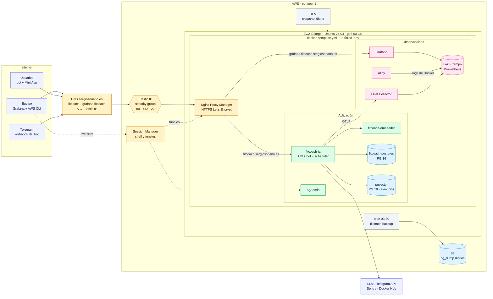

# Despliegue en AWS sobre una única instancia EC2

Despliegue de FitCoachIA en una instancia EC2 de AWS. Todo el sistema se define en un único
[`docker-compose.yml`](../docker-compose.yml): la aplicación, el embedder, las dos bases de datos,
pgAdmin, el stack de observabilidad del proyecto (Grafana, Loki, Tempo, Prometheus, OTel Collector y
Alloy) y Nginx Proxy Manager. Toda la configuración está en un único fichero `.env`. La
infraestructura de AWS se crea con una plantilla de **CloudFormation**:
[`infra/aws/ec2/fitcoach-ec2.cfn.yaml`](../infra/aws/ec2/fitcoach-ec2.cfn.yaml).

No se usan servicios de observabilidad de AWS (CloudWatch Logs, X-Ray, Managed Grafana): trazas,
logs y métricas siguen en el stack de [observabilidad.md](observabilidad.md).

El documento tiene tres partes:

- **Visión general** (secciones 1 y 2): qué se monta y en qué orden se hace.
- **Puesta en marcha, paso a paso** (secciones 3 a 11): en el orden en que se hace, la primera vez.
- **Operación y referencia** (secciones 12 a 14): backups, actualizaciones, coste y decisiones.

---

## 1. Visión general

### 1.1 Resumen

| Pieza | En la instancia |
| --- | --- |
| Máquina | EC2 `t3.large` (2 vCPU, 8 GB, x86_64), Ubuntu 24.04 LTS, disco gp3 de 60 GB |
| Infraestructura | Plantilla CloudFormation: instancia, Elastic IP, security group, rol, bucket de backups y snapshots |
| Contenedores | Un único `docker-compose.yml` (proyecto `fitcoach`) con todos los servicios, incluido Nginx Proxy Manager |
| Imágenes | Se construyen en la instancia desde el repositorio (`docker compose up -d --build`) |
| Configuración | Un único `/opt/fitcoachia/.env`, propiedad de root con permisos `600` |
| Dominio | `fitcoach.sergiosoriano.es` (API, bot y Mini App) y `grafana.fitcoach.sergiosoriano.es` |
| HTTPS | Nginx Proxy Manager con certificados de Let's Encrypt |
| Acceso del equipo | Session Manager con el usuario de AWS de cada persona; sin claves compartidas |
| Datos | Producción arranca con las bases vacías: no se migra nada |
| Backups | Snapshots EBS diarios (DLM) + `pg_dump` nocturno a S3 |

Se elige **x86_64** (`t3`) y no Graviton (`t4g`) porque es la arquitectura con la que se prueban hoy
las imágenes. Pasar a ARM queda como mejora posterior.

Coste orientativo en `eu-west-1`, bajo demanda: **≈ 77 USD/mes** (≈ 54 $ con un Savings Plan de
1 año). Detalle en la [sección 13](#13-coste).

### 1.2 Diagrama



Las líneas discontinuas son acceso de administración o tareas de AWS. Grafana lee además
`fitcoach-postgres` para los dashboards de negocio. El Compose crea tres redes: `proxy-network` une
Nginx Proxy Manager con la API, Grafana y pgAdmin; `fitcoach-internal` une la aplicación con sus
bases de datos, el embedder, el collector y Grafana; `observability` es la red interna del stack de
observabilidad.

### 1.3 Qué crea la plantilla

| Recurso | Para qué |
| --- | --- |
| Security group | 443 y 80 desde internet (IPv4 e IPv6); 22 desde `SshIngressCidr` (para `deploy.yml`) |
| Instancia EC2 | Ubuntu 24.04, `t3.large` por defecto, crédito *unlimited*, IMDSv2 obligatorio, protección contra terminación, disco gp3 cifrado de 60 GB que **no** se borra si se termina la instancia |
| Elastic IP | IP fija para el DNS y para el secreto `SERVER_HOST`; se reasocia sola si la instancia se sustituye |
| Rol de instancia | Session Manager (shell y túneles sin abrir puertos) y escritura en `postgres/` del bucket de backups |
| Bucket S3 | Backups de Postgres, cifrado, sin acceso público, borra los volcados a los `BackupRetentionDays` días. Se conserva si se borra la pila |
| Política DLM | Snapshot diario de la instancia a las 03:00 UTC, conserva `SnapshotRetentionCount` |

En el primer arranque, el *user data* prepara la instancia:

1. Docker Engine (≥ 25, necesario por `start_interval` de los healthchecks), el plugin Compose,
   `make`, `git` y la AWS CLI.
2. Rotación de logs de Docker (`json-file`, 3 × 10 MB por contenedor). Alloy los sigue leyendo por
   la API de Docker.
3. 2 GB de swap.
4. Usuario de despliegue en el grupo `docker`, con la clave pública de GitHub Actions y la regla
   `sudoers` que exige `deploy.yml` ([how-to.md](how-to.md#desplegar-producción)).
5. El repositorio en `/opt/fitcoachia` (rama o tag `RepositoryRef`), que es el contexto de
   construcción de todas las imágenes, y una copia de `docker-compose.yml` y `Makefile` en el *home*
   del usuario de despliegue, para `deploy.yml`.
6. El backup nocturno (`/etc/cron.d/fitcoach-backup`).

No arranca ningún contenedor: el Compose necesita el `.env` con los secretos, que no debe pasar por
CloudFormation (quedaría visible en el *user data*). Las redes y los volúmenes los crea el propio
Compose al arrancar.

---

## 2. Hoja de ruta

Todos los pasos de la puesta en marcha, en orden. Los que dependen de otra persona van marcados
para pedirlos con tiempo.

| # | Paso | Quién | Dónde | Sección |
| --- | --- | --- | --- | --- |
| 1 | Preparar el equipo: AWS CLI, plugin de Session Manager, perfil SSO | Cada integrante | Su equipo | [3](#3-preparar-el-equipo) |
| 2 | Generar la clave de despliegue y crear la pila | Administrador de AWS | Su equipo | [4](#4-crear-la-pila) |
| 3 | Crear el registro DNS de `fitcoach.sergiosoriano.es` | **Quien gestiona `sergiosoriano.es`** | Su proveedor de DNS | [5](#5-pedir-el-dns) |
| 4 | Dar acceso al resto del equipo | Administrador de AWS | IAM Identity Center | [6](#6-acceso-del-equipo) |
| 5 | Actualizar el repositorio y crear el `.env` | Quien despliega | Instancia | [7](#7-configurar-la-instancia) |
| 6 | Arrancar todo con un solo comando | Quien despliega | Instancia | [8](#8-arrancar-el-sistema) |
| 7 | Crear las dos reglas del proxy y su certificado | Quien despliega | Panel de NPM | [9](#9-reglas-del-proxy-en-nginx-proxy-manager) |
| 8 | Mover `grafana.fitcoach` y revisar BotFather | **Quien gestiona `sergiosoriano.es`** | DNS, BotFather | [10](#10-cerrar-la-puesta-en-marcha) |
| 9 | Comprobar que todo funciona | Quien despliega | Telegram, Grafana, S3 | [11](#11-comprobar) |

---

## 3. Preparar el equipo

Una vez por persona, en el equipo desde el que se trabaja:

- **AWS CLI v2** (`aws --version`). La v1 no admite SSO.
- **Plugin de Session Manager** para la AWS CLI, necesario para `aws ssm start-session` (instalador
  oficial de AWS para Windows, macOS o Linux).
- **Perfil SSO** de su usuario de IAM Identity Center, creado con `aws configure sso`. Quien crea la
  pila necesita permisos de administrador (la pila crea roles de IAM); nunca el usuario root. El
  resto, el *permission set* de la [sección 6](#6-acceso-del-equipo). La sesión caduca a las pocas
  horas y se renueva con `aws sso login`.

Los comandos van en dos versiones, cada una con su etiqueta: **PowerShell (Windows)** y **bash
(Linux, macOS, WSL)**; los que sirven igual en las dos se indican como tales, y los que se ejecutan
dentro de la instancia, como **bash (en la instancia)**. Todos usan explícitamente el perfil de la
AWS CLI, aquí `fitcoach`, y la región `eu-west-1` (Irlanda; `eu-south-2`, Madrid, también vale). Si
el perfil se llama de otra forma, `aws configure list-profiles` lo muestra.

Al empezar cada sesión de trabajo, definir las variables e iniciar sesión. `$InstanceId` /
`INSTANCE_ID` sale de las salidas de la pila ([sección 4.4](#44-después-de-crearla)): hasta crearla
se deja vacía.

**PowerShell (Windows):**

```powershell
$AwsProfile = "fitcoach"
$Region = "eu-west-1"
$InstanceId = "i-xxxxxxxxxxxxxxxxx"
aws sso login --profile $AwsProfile
aws sts get-caller-identity --profile $AwsProfile   # debe devolver la cuenta y el rol
```

**bash (Linux, macOS, WSL):**

```bash
AWS_PROFILE_NAME=fitcoach
REGION=eu-west-1
INSTANCE_ID=i-xxxxxxxxxxxxxxxxx
aws sso login --profile "$AWS_PROFILE_NAME"
aws sts get-caller-identity --profile "$AWS_PROFILE_NAME"
```

Las variables de PowerShell (`$AwsProfile`, `$Region`, `$PubKey`, `$Ami`...) son variables normales de
la sesión: no llevan `$env:`, que solo se usa para variables de entorno
([about_Variables](https://learn.microsoft.com/es-es/powershell/module/microsoft.powershell.core/about/about_variables),
[about_Environment_Variables](https://learn.microsoft.com/es-es/powershell/module/microsoft.powershell.core/about/about_environment_variables)).
Funcionan porque PowerShell sustituye su valor en el argumento antes de lanzar `aws`. Duran lo que
dura la ventana, así que los bloques se ejecutan en orden en la misma.

---

## 4. Crear la pila

Lo hace una vez un administrador de AWS, desde la raíz del repositorio.

### 4.1 Clave SSH de despliegue

La instancia se crea con la clave pública que se le pase en `DeploySshPublicKey`, y la escribe en el
`authorized_keys` del usuario de despliegue al arrancar. Es la clave que usará `deploy.yml`: su parte
privada acabará en el secreto `SERVER_PKEY` de GitHub. Se genera una pareja nueva, sin contraseña
(GitHub Actions no puede teclearla):

**PowerShell (Windows):**

```powershell
New-Item -ItemType Directory -Force $HOME\.ssh | Out-Null
ssh-keygen -t ed25519 -f $HOME\.ssh\fitcoach-deploy -C github-actions-deploy   # Enter dos veces
$PubKey = (Get-Content $HOME\.ssh\fitcoach-deploy.pub -Raw).Trim()
```

**bash (Linux, macOS, WSL):**

```bash
ssh-keygen -t ed25519 -f ~/.ssh/fitcoach-deploy -C github-actions-deploy -N ''
PUBKEY=$(cat ~/.ssh/fitcoach-deploy.pub)
```

- La clave privada (`fitcoach-deploy`, sin `.pub`) se entrega al administrador del repositorio por un
  canal seguro, nunca por chat o correo sin cifrar, y la guarda en `SERVER_PKEY` al final de la
  puesta en marcha ([sección 10](#10-cerrar-la-puesta-en-marcha)). Hasta entonces `deploy.yml` sigue
  desplegando en el servidor actual con la clave de siempre.
- Esta clave es solo para `deploy.yml`: las personas entran con su propio usuario
  ([sección 6](#6-acceso-del-equipo)).

### 4.2 AMI, VPC y subred

**PowerShell (Windows):**

```powershell
$Ami = aws ssm get-parameter --profile $AwsProfile --region $Region `
  --name /aws/service/canonical/ubuntu/server/24.04/stable/current/amd64/hvm/ebs-gp3/ami-id `
  --query Parameter.Value --output text
$VpcId = aws ec2 describe-vpcs --profile $AwsProfile --region $Region `
  --filters "Name=isDefault,Values=true" --query "Vpcs[0].VpcId" --output text
aws ec2 describe-subnets --profile $AwsProfile --region $Region `
  --filters "Name=vpc-id,Values=$VpcId" --query "Subnets[].[SubnetId,AvailabilityZone]" --output table
$SubnetId = "subnet-xxxxxxxx"   # una de la tabla anterior
```

**bash (Linux, macOS, WSL):**

```bash
AMI=$(aws ssm get-parameter --profile "$AWS_PROFILE_NAME" --region "$REGION" \
  --name /aws/service/canonical/ubuntu/server/24.04/stable/current/amd64/hvm/ebs-gp3/ami-id \
  --query Parameter.Value --output text)
VPC_ID=$(aws ec2 describe-vpcs --profile "$AWS_PROFILE_NAME" --region "$REGION" \
  --filters Name=isDefault,Values=true --query 'Vpcs[0].VpcId' --output text)
aws ec2 describe-subnets --profile "$AWS_PROFILE_NAME" --region "$REGION" \
  --filters "Name=vpc-id,Values=$VPC_ID" --query 'Subnets[].[SubnetId,AvailabilityZone]' --output table
SUBNET_ID=subnet-xxxxxxxx   # una de la tabla anterior
```

La AMI queda fijada como parámetro de la pila y no se resuelve sola: así una actualización no
sustituye la instancia por sorpresa ([sección 12.2](#122-actualizar-la-pila)).

### 4.3 Crear el change set, revisarlo y ejecutarlo

`RepositoryRef` es la rama o el tag que la instancia clona en `/opt/fitcoachia`. Debe contener
`infra/aws/ec2/`: si no, el arranque falla al no encontrar el script de backup. Mientras esta carpeta
no esté en `develop` (el valor por defecto), usar `feat/cloud-architecture`.

`--no-execute-changeset` prepara los cambios sin aplicarlos, para revisarlos antes:

**PowerShell (Windows):**

```powershell
aws cloudformation deploy --profile $AwsProfile --region $Region `
  --stack-name fitcoach-prod `
  --template-file infra/aws/ec2/fitcoach-ec2.cfn.yaml `
  --capabilities CAPABILITY_IAM `
  --no-execute-changeset `
  --parameter-overrides "VpcId=$VpcId" "SubnetId=$SubnetId" "ImageId=$Ami" `
    "DeploySshPublicKey=$PubKey" "RepositoryRef=feat/cloud-architecture"
```

**bash (Linux, macOS, WSL):**

```bash
aws cloudformation deploy --profile "$AWS_PROFILE_NAME" --region "$REGION" \
  --stack-name fitcoach-prod \
  --template-file infra/aws/ec2/fitcoach-ec2.cfn.yaml \
  --capabilities CAPABILITY_IAM \
  --no-execute-changeset \
  --parameter-overrides "VpcId=$VPC_ID" "SubnetId=$SUBNET_ID" "ImageId=$AMI" \
    "DeploySshPublicKey=$PUBKEY" "RepositoryRef=feat/cloud-architecture"
```

El comando termina imprimiendo el ARN del change set. Para revisarlo, ejecutarlo y esperar a que
termine (cada comando en una línea):

**PowerShell y bash (iguales):**

```shell
aws cloudformation describe-change-set --profile fitcoach --region eu-west-1 --change-set-name <arn-del-change-set> --query "Changes[].ResourceChange.[Action,LogicalResourceId,Replacement]" --output table
aws cloudformation execute-change-set --profile fitcoach --region eu-west-1 --change-set-name <arn-del-change-set>
aws cloudformation wait stack-create-complete --profile fitcoach --region eu-west-1 --stack-name fitcoach-prod
```

También se puede revisar y ejecutar desde la consola de CloudFormation (pestaña *Change sets*).

### 4.4 Después de crearla

Activar la protección contra borrado y ver las salidas de la pila:

**PowerShell y bash (iguales):**

```shell
aws cloudformation update-termination-protection --profile fitcoach --region eu-west-1 --enable-termination-protection --stack-name fitcoach-prod
aws cloudformation describe-stacks --profile fitcoach --region eu-west-1 --stack-name fitcoach-prod --query "Stacks[0].Outputs" --output table
```

Apuntar dos salidas, que se usan en el resto del documento:

- `InstanceId`: el valor de `$InstanceId` / `INSTANCE_ID` ([sección 3](#3-preparar-el-equipo)).
- `PublicIp`: la Elastic IP, para el DNS ([sección 5](#5-pedir-el-dns)) y `SERVER_HOST`.

---

## 5. Pedir el DNS

Producción usa `fitcoach.sergiosoriano.es`, sin etiqueta de entorno; desarrollo sigue en
`dev.fitcoach.sergiosoriano.es`. No se registra ningún dominio nuevo: es un nombre más de la zona
`sergiosoriano.es`, y lo crea quien gestiona esa zona en su proveedor de DNS actual. Conviene pedirlo
en cuanto exista la pila, porque Nginx Proxy Manager lo necesita para sacar el certificado
([sección 9](#9-reglas-del-proxy-en-nginx-proxy-manager)).

| Nombre | Tipo | Valor | TTL | Cuándo |
| --- | --- | --- | --- | --- |
| `fitcoach` | `A` | Elastic IP (`PublicIp`) | 300 | En cuanto exista la pila |
| `grafana.fitcoach` | `A` | Elastic IP (`PublicIp`) | 60 | Al final ([sección 10](#10-cerrar-la-puesta-en-marcha)) |
| `dev.fitcoach` | — | Sin cambios | — | — |

Pedirle también que compruebe:

- Que `fitcoach` no tenga ya un `CNAME` ni un `AAAA`. Un `AAAA` haría fallar a Let's Encrypt, porque la
  instancia no tiene IPv6.
- Que, si la zona tiene registros `CAA`, permitan `letsencrypt.org`.

Comprobar que ya resuelve a la Elastic IP:

**PowerShell (Windows):**

```powershell
Resolve-DnsName fitcoach.sergiosoriano.es -Type A
```

**bash (Linux, macOS, WSL):**

```bash
dig +short fitcoach.sergiosoriano.es A
```

---

## 6. Acceso del equipo

Cada integrante entra en la instancia **con su propio usuario de AWS a través de Session Manager**,
sin claves SSH compartidas y sin usar el puerto 22 (que queda solo para `deploy.yml`). La plantilla ya
da a la instancia el permiso de Session Manager.

- Cada sesión queda registrada a nombre de quien la abre.
- No hay claves de equipo que guardar ni rotar.
- Quitar el acceso a alguien es desactivar su usuario en IAM Identity Center.

No se debe repartir una clave común ni la clave de `deploy.yml`: no se sabría quién hace qué y, si
alguien deja el proyecto, habría que cambiarla para todos.

### 6.1 Usuarios en IAM Identity Center (un administrador, una vez)

1. En IAM Identity Center, crear un usuario por integrante (o un grupo `fitcoach` con los cuatro).
2. Asignarles la cuenta de AWS con un *permission set*:
   - `AdministratorAccess` para quien vaya a crear o actualizar la pila.
   - Para quien solo necesita entrar en la máquina, un *permission set* propio (p. ej.
     `FitCoachInstanceAccess`) con esta política en línea, sustituyendo `<cuenta>` e `<instance-id>`:

```json
{
  "Version": "2012-10-17",
  "Statement": [
    {
      "Sid": "StartSessionOnFitCoachInstance",
      "Effect": "Allow",
      "Action": "ssm:StartSession",
      "Resource": [
        "arn:aws:ec2:eu-west-1:<cuenta>:instance/<instance-id>",
        "arn:aws:ssm:eu-west-1::document/AWS-StartSSHSession",
        "arn:aws:ssm:eu-west-1::document/AWS-StartPortForwardingSession",
        "arn:aws:ssm:eu-west-1:<cuenta>:document/SSM-SessionManagerRunShell"
      ]
    },
    {
      "Sid": "ManageOwnSessions",
      "Effect": "Allow",
      "Action": ["ssm:TerminateSession", "ssm:ResumeSession"],
      "Resource": "arn:aws:ssm:*:*:session/*"
    },
    {
      "Sid": "TemporarySshKey",
      "Effect": "Allow",
      "Action": "ec2-instance-connect:SendSSHPublicKey",
      "Resource": "arn:aws:ec2:eu-west-1:<cuenta>:instance/<instance-id>",
      "Condition": { "StringEquals": { "ec2:osuser": "ubuntu" } }
    },
    {
      "Sid": "Discover",
      "Effect": "Allow",
      "Action": [
        "ec2:DescribeInstances",
        "ssm:DescribeInstanceInformation",
        "ssm:DescribeSessions",
        "ssm:GetConnectionStatus"
      ],
      "Resource": "*"
    }
  ]
}
```

### 6.2 Entrar en la instancia

Con las variables de la [sección 3](#3-preparar-el-equipo) ya definidas:

**PowerShell (Windows):**

```powershell
aws ssm start-session --profile $AwsProfile --region eu-west-1 --target $InstanceId
```

**bash (Linux, macOS, WSL):**

```bash
aws ssm start-session --profile "$AWS_PROFILE_NAME" --region eu-west-1 --target "$INSTANCE_ID"
```

Se entra como `ssm-user`, que tiene `sudo`. Para trabajar con más comodidad: `sudo -iu ubuntu` o
`bash -l`. Ojo: el usuario de despliegue (`fitcoach` por defecto) es otro, y su *home* es
`/home/fitcoach`.

### 6.3 Túneles a paneles internos

Los paneles de administración no se publican en internet. Se abre un túnel por Session Manager, se
deja la ventana abierta mientras se usa y el panel queda en `http://localhost:<puerto-local>`:

**PowerShell y bash (iguales):**

```shell
aws ssm start-session --profile fitcoach --region eu-west-1 --target <instance-id> --document-name AWS-StartPortForwardingSession --parameters "portNumber=81,localPortNumber=8081"
```

| Panel | `portNumber` | Ejemplo de `localPortNumber` |
| --- | --- | --- |
| Nginx Proxy Manager | `81` | `8081` |
| pgAdmin (las dos bases) | `PGADMIN_PORT` del `.env` | `8010` |

En PowerShell, las comillas de `--parameters` son obligatorias: sin ellas la coma parte el argumento
en dos.

### 6.4 SSH por encima de Session Manager (opcional)

Para `scp`, `rsync` o VS Code Remote-SSH hace falta SSH. Se puede usar sin abrir el puerto 22 a las
personas y sin claves permanentes en el servidor: cada integrante tiene **su propia clave**, la envía
a la instancia con EC2 Instance Connect (vale 60 segundos, el tiempo de abrir la conexión) y la
conexión viaja por Session Manager. Ubuntu 24.04 ya trae EC2 Instance Connect instalado.

1. **Una vez**, generar la clave personal (con contraseña: es solo suya) y añadir el alias a
   `~/.ssh/config`.

   **PowerShell (Windows):**

   ```powershell
   New-Item -ItemType Directory -Force $HOME\.ssh | Out-Null
   ssh-keygen -t ed25519 -f $HOME\.ssh\fitcoach-personal -C "<su-nombre>"
   ```

   Añadir a `$HOME\.ssh\config` (sustituyendo el perfil y el `instance-id`):

   ```text
   Host fitcoach-ec2
       HostName i-xxxxxxxxxxxxxxxxx
       User ubuntu
       IdentityFile ~/.ssh/fitcoach-personal
       ProxyCommand C:\Windows\System32\WindowsPowerShell\v1.0\powershell.exe "aws ssm start-session --profile fitcoach --region eu-west-1 --target %h --document-name AWS-StartSSHSession --parameters portNumber=%p"
   ```

   **bash (Linux, macOS, WSL):**

   ```bash
   ssh-keygen -t ed25519 -f ~/.ssh/fitcoach-personal -C "<su-nombre>"
   ```

   Añadir a `~/.ssh/config`:

   ```text
   Host fitcoach-ec2
       HostName i-xxxxxxxxxxxxxxxxx
       User ubuntu
       IdentityFile ~/.ssh/fitcoach-personal
       ProxyCommand sh -c "aws ssm start-session --profile fitcoach --region eu-west-1 --target %h --document-name AWS-StartSSHSession --parameters 'portNumber=%p'"
   ```

2. **Cada vez**, enviar la clave pública y conectar (o lanzar `scp`) en menos de 60 segundos.

   **PowerShell (Windows):**

   ```powershell
   aws ec2-instance-connect send-ssh-public-key --profile $AwsProfile --region eu-west-1 --instance-id $InstanceId --instance-os-user ubuntu --ssh-public-key "file://$HOME/.ssh/fitcoach-personal.pub"
   ssh fitcoach-ec2
   ```

   **bash (Linux, macOS, WSL):**

   ```bash
   aws ec2-instance-connect send-ssh-public-key --profile "$AWS_PROFILE_NAME" --region eu-west-1 --instance-id "$INSTANCE_ID" --instance-os-user ubuntu --ssh-public-key "file://$HOME/.ssh/fitcoach-personal.pub"
   ssh fitcoach-ec2
   ```

   La clave solo hace falta para abrir la conexión: una sesión ya abierta sigue viva aunque pasen los
   60 segundos. VS Code Remote-SSH usa el alias `fitcoach-ec2`; si se reconecta, hay que volver a
   enviar la clave.

---

## 7. Configurar la instancia

Una sola vez. Producción no llegó a funcionar en el servidor actual, así que **no se migran datos**:
lo único que hay que llevar a la instancia es el `.env`.

### 7.1 Comprobar el arranque y actualizar el repositorio

Entrar en la instancia ([sección 6.2](#62-entrar-en-la-instancia)) y:

**bash (en la instancia):**

```bash
# Esperar a que termine el user data: debe acabar en "status: done"
cloud-init status --wait

# Traer el repositorio a la última versión de la rama y reinstalar el script de backup
sudo git -C /opt/fitcoachia pull
sudo install -m 755 /opt/fitcoachia/infra/aws/ec2/backup-postgres.sh /usr/local/bin/fitcoach-backup
```

Si `cloud-init` termina en error, el detalle está en `/var/log/cloud-init-output.log`.

### 7.2 El fichero `.env`

Toda la configuración va en un único fichero, `/opt/fitcoachia/.env`, a partir de la plantilla
[`.env.example`](../.env.example). Docker Compose lo lee solo, porque está junto a
`docker-compose.yml`: no hacen falta `--env-file` ni variables adicionales. Sale del gestor de
secretos del equipo, nunca del repositorio (está en `.gitignore`), y se instala con permisos `600` de
`root`.

**Valores a revisar antes de copiarlo:**

| Variable | Valor en producción |
| --- | --- |
| `DEPLOYMENT_ENVIRONMENT` | `prod` |
| `bot_telegram_token`, `bot_telegram_secret_token` | Los del **bot de producción**, distinto del de desarrollo ([telegram-environments.md](telegram-environments.md)) |
| `bot_telegram_webhook_base_url` | `https://fitcoach.sergiosoriano.es` |
| `miniapp_url` | `https://fitcoach.sergiosoriano.es/miniapp/` |
| `GF_SERVER_ROOT_URL` | `https://grafana.fitcoach.sergiosoriano.es` |
| `GF_ADMIN_PASSWORD` | Contraseña del usuario `admin` de Grafana |
| `GF_ALERT_SEVERITY` | `critical` (por defecto es `warning`, el valor de desarrollo) |
| `POSTGRES_PASSWORD` | La misma que en `database_url` |
| `VECTOR_PASSWORD` | Contraseña del superusuario de pgVector |
| `VECTOR_DB_RO_PASSWORD`, `VECTOR_DB_WRITER_PASSWORD` | Las mismas que en `vector_database_url` y `vector_database_writer_url` |
| `PGADMIN_DEFAULT_EMAIL`, `PGADMIN_DEFAULT_PASSWORD` | Acceso a pgAdmin |
| `otel_exporter_otlp_endpoint` | `http://otel-collector:4317` (ya en la plantilla) |

Las contraseñas de las bases solo se aplican al **crear** sus volúmenes; cambiarlas después en el
`.env` no cambia las que ya tienen ([entornos-y-despliegue.md](entornos-y-despliegue.md)).

**Opción A: `scp`.** Necesita el alias `fitcoach-ec2` de la [sección 6.4](#64-ssh-por-encima-de-session-manager-opcional).
Desde la carpeta local donde esté el fichero (aquí `fitcoach.env`), enviar la clave y lanzar `scp`
en menos de 60 segundos. El fichero queda en `/home/ubuntu` (no en `/tmp`, que es de todos):

**PowerShell (Windows):**

```powershell
aws ec2-instance-connect send-ssh-public-key --profile $AwsProfile --region eu-west-1 --instance-id $InstanceId --instance-os-user ubuntu --ssh-public-key "file://$HOME/.ssh/fitcoach-personal.pub"
scp .\fitcoach.env fitcoach-ec2:
```

**bash (Linux, macOS, WSL):**

```bash
aws ec2-instance-connect send-ssh-public-key --profile "$AWS_PROFILE_NAME" --region eu-west-1 --instance-id "$INSTANCE_ID" --instance-os-user ubuntu --ssh-public-key "file://$HOME/.ssh/fitcoach-personal.pub"
scp ./fitcoach.env fitcoach-ec2:
```

Después, en la instancia, instalarlo en su sitio y borrar la copia:

**bash (en la instancia):**

```bash
sudo install -m 600 -o root -g root /home/ubuntu/fitcoach.env /opt/fitcoachia/.env
sudo shred -u /home/ubuntu/fitcoach.env
```

**Opción B: pegar el contenido, sin SSH.** Desde Session Manager, crear el fichero en su destino y
pegar el contenido en el editor:

**bash (en la instancia):**

```bash
sudo install -m 600 -o root -g root /dev/null /opt/fitcoachia/.env
sudo nano /opt/fitcoachia/.env
```

No usar S3 como paso intermedio: los secretos quedarían guardados en el bucket (y en sus versiones),
y el rol de la instancia solo puede leer `postgres/`.

### 7.3 Login de Docker Hub (solo si hace falta)

Las imágenes base (Postgres, pgAdmin, Grafana, Nginx Proxy Manager...) se descargan de Docker Hub sin
cuenta. Si el límite de descargas anónimas diera problemas, hacer login:

**bash (en la instancia):**

```bash
sudo docker login
```

### 7.4 Si la instancia ya tenía la instalación anterior

Solo para una instancia preparada con la versión anterior de este documento, que usaba un Compose por
pieza (aplicación, pgVector, observabilidad y Nginx Proxy Manager) y un `.env` por pieza. Esos
contenedores tienen los mismos nombres que los del Compose único y las redes externas que creaban
chocarían con las suyas, así que se retiran antes del primer arranque.

**bash (en la instancia):**

```bash
# 1. Parar y borrar los contenedores anteriores (los que no existan dan un error y se ignoran)
sudo docker rm -f fitcoach-ia fitcoach-embedder fitcoach-postgres pgadmin4-prod pgvector pgadmin \
  fitcoach-grafana fitcoach-prometheus fitcoach-loki fitcoach-tempo fitcoach-otel-collector \
  fitcoach-alloy nginx-proxy-manager

# 2. Conservar las reglas y certificados de Nginx Proxy Manager en los volúmenes nuevos
sudo docker volume create fitcoach_npm-data
sudo docker volume create fitcoach_npm-letsencrypt
sudo docker run --rm -v nginx-proxy-manager_npm-data:/from -v fitcoach_npm-data:/to alpine cp -a /from/. /to/
sudo docker run --rm -v nginx-proxy-manager_npm-letsencrypt:/from -v fitcoach_npm-letsencrypt:/to alpine cp -a /from/. /to/

# 3. Borrar las redes externas anteriores: el Compose crea las suyas
sudo docker network rm proxy-network fitcoach-prod-internal fitcoach-dev-internal

# 4. Pasar los valores de los .env anteriores al .env único (7.2) y borrar los antiguos
sudo shred -u /etc/fitcoachia/prod/.env.prod /opt/fitcoachia/infra/vector-db/.env.prod \
  /opt/fitcoachia/infra/observability/.env
```

Compose avisará de que `fitcoach_npm-data` y `fitcoach_npm-letsencrypt` «ya existen pero no los creó
Compose»: es esperado y los usa igualmente. Las bases de datos y el histórico de observabilidad
arrancan en volúmenes nuevos y vacíos. Los anteriores (los que empiezan por `fitcoach-prod_`,
`fitcoach-vector-db_`, `fitcoach-observability_` y `nginx-proxy-manager_`) se pueden borrar con
`sudo docker volume rm` cuando todo funcione.

---

## 8. Arrancar el sistema

**Antes de nada, comprobar que no hay ninguna API de producción viva en el servidor actual.** Dos
APIs con el mismo bot se quitarían el webhook la una a la otra y sus schedulers enviarían avisos
duplicados:

**bash (servidor actual):**

```bash
docker ps --filter name=fitcoach-ia --format '{{.Names}}'
# Si aparece "fitcoach-ia" (la de producción; la de desarrollo es otra), pararla:
sudo make prod-down
```

Después, en la instancia, un solo comando arranca todo:

**bash (en la instancia):**

```bash
cd /opt/fitcoachia
sudo docker compose up -d --build
sudo docker compose ps
```

Qué ocurre, en orden:

1. **Construcción de imágenes**: la aplicación, el embedder, pgVector y las seis piezas de
   observabilidad, con su configuración ya dentro de la imagen. La primera vez tarda varios minutos.
2. **Redes y volúmenes**: `proxy-network`, `fitcoach-internal` y `observability`, y un volumen por
   base de datos y por componente de observabilidad.
3. **pgVector**: con el volumen vacío, ejecuta los scripts de `infra/vector-db/ddl/` (catálogo de
   ejercicios y roles `fitcoach_ro` y `fitcoach_writer`). Solo ocurre la primera vez y puede tardar
   varios minutos; la API espera a que esté sano. Se sigue con `sudo docker compose logs -f pgvector`.
4. **API**: ejecuta las migraciones de Alembic, que crean las tablas en `fitcoach-postgres`, registra
   el webhook del bot con `https://fitcoach.sergiosoriano.es` y el botón de menú con la `miniapp_url`.
5. **Nginx Proxy Manager**: arranca el último, cuando la API, Grafana y pgAdmin están sanos.

`APP_PORT`, `VECTOR_PORT` y `PGADMIN_PORT` quedan publicados en la instancia, pero el security group
solo deja pasar 80, 443 y 22: desde fuera solo se llega por Nginx Proxy Manager, y a pgAdmin por
túnel ([sección 6.3](#63-túneles-a-paneles-internos)).

---

## 9. Reglas del proxy en Nginx Proxy Manager

Nginx Proxy Manager (NPM) es la única puerta de entrada desde internet. Cada regla, un *Proxy Host*,
dice «las peticiones que llegan a este dominio van a este contenedor y a este puerto», y además
gestiona su certificado HTTPS de Let's Encrypt. En producción hacen falta **dos reglas**: la de la
API y la de Grafana. NPM no permite exportar reglas, así que se crean a mano; las de desarrollo siguen
en el servidor actual y no se tocan. NPM y los contenedores a los que reenvía comparten la red
`proxy-network`, así que el destino se escribe con el nombre del contenedor, no con una IP.

**1. Abrir el panel** con el túnel de la [sección 6.3](#63-túneles-a-paneles-internos)
(`portNumber=81`): queda en `http://localhost:8081`.

**2. Primer acceso.** NPM arranca con su administrador por defecto:

- Email: `admin@example.com`
- Contraseña: `changeme`

Nada más entrar, NPM obliga a cambiar el nombre, el email y la contraseña. Usar un email del equipo
(es también el que se propone para los avisos de Let's Encrypt) y guardar la contraseña en el gestor
de contraseñas del equipo. Si se conservaron los datos de una instalación anterior
([sección 7.4](#74-si-la-instancia-ya-tenía-la-instalación-anterior)), se entra con el usuario que ya
existía y las reglas ya están creadas: solo hay que revisar el destino de la regla de la API, que
antes era `fitcoach-ia-prod` y ahora es `fitcoach-ia`.

**3. Regla de la API y del bot.** *Hosts* → *Proxy Hosts* → *Add Proxy Host*.

| Pestaña | Campo | Valor |
| --- | --- | --- |
| Details | Domain Names | `fitcoach.sergiosoriano.es` |
| Details | Scheme | `http` |
| Details | Forward Hostname / IP | `fitcoach-ia` |
| Details | Forward Port | `8000` |
| Details | Cache Assets, Websockets Support, Access List | Sin marcar / *Publicly Accessible* |
| SSL | SSL Certificate | *Request a new SSL Certificate* |
| SSL | Force SSL y HTTP/2 Support | Marcados |
| SSL | Email Address for Let's Encrypt | El email del equipo |
| SSL | I Agree to the Let's Encrypt Terms of Service | Marcado |

Guardar. NPM pide el certificado en ese momento: solo funciona si `fitcoach.sergiosoriano.es` ya
apunta a la Elastic IP ([sección 5](#5-pedir-el-dns)). Esta regla atiende el webhook de Telegram
(`/webhook/response`) y la Mini App (`/miniapp/` y `/api/miniapp/`); no necesita *Custom Locations* ni
configuración avanzada, y no debe llevar *Access List*, porque Telegram no envía credenciales
([telegram-miniapp.md](telegram-miniapp.md#nginx-proxy-manager)).

**4. Regla de Grafana.** Igual, con estos valores:

| Pestaña | Campo | Valor |
| --- | --- | --- |
| Details | Domain Names | `grafana.fitcoach.sergiosoriano.es` |
| Details | Scheme | `http` |
| Details | Forward Hostname / IP | `fitcoach-grafana` |
| Details | Forward Port | `3000` |
| SSL | SSL Certificate | *None* por ahora |

El certificado de Grafana se pide al final, cuando `grafana.fitcoach.sergiosoriano.es` ya apunte a la
instancia ([sección 10](#10-cerrar-la-puesta-en-marcha)). Grafana tiene su propio login, así que una
*Access List* de NPM es opcional. pgAdmin también está en `proxy-network`, pero no se publica: se usa
por túnel.

**5. Comprobar la regla de la API.** Debe responder `200`:

**PowerShell (Windows):**

```powershell
curl.exe -I https://fitcoach.sergiosoriano.es/health
```

**bash (Linux, macOS, WSL):**

```bash
curl -I https://fitcoach.sergiosoriano.es/health
```

En PowerShell 5.1, `curl` a secas es un alias de `Invoke-WebRequest`; `curl.exe` es el curl real.
Un `502 Bad Gateway` indica que la regla funciona pero la API no responde: revisar
`sudo docker compose ps` y `sudo docker compose logs fitcoach-ia`.

---

## 10. Cerrar la puesta en marcha

1. **DNS de Grafana.** Pedir a quien gestiona `sergiosoriano.es` que cambie el registro `A` de
   `grafana.fitcoach` a la Elastic IP ([sección 5](#5-pedir-el-dns)). Cuando resuelva, editar la regla
   de Grafana en NPM (*Edit* → *SSL*) y pedir el certificado como en la regla de la API. El Grafana del
   servidor actual deja de tener nombre público; se puede seguir usando por túnel o con otro nombre.
2. **BotFather.** Si el bot de producción tiene la Mini App configurada también en BotFather
   (*Main Mini App*), cambiar allí la URL a `https://fitcoach.sergiosoriano.es/miniapp/`.
3. **Secretos de GitHub** (`SERVER_PKEY` con la clave de la [sección 4.1](#41-clave-ssh-de-despliegue),
   `SERVER_HOST` y `SERVER_USER`): se cambian cuando `deploy.yml` esté adaptado al Compose único
   ([sección 14](#14-decisiones-y-puntos-abiertos)). Hasta entonces, las actualizaciones se hacen a
   mano ([sección 12.3](#123-actualizar-la-aplicación)).

---

## 11. Comprobar

- `sudo docker compose ps`: todos los servicios `running` y, los que tienen healthcheck, `healthy`.
- `https://api.telegram.org/bot<TOKEN>/getWebhookInfo` (con el token del bot de producción): `url`
  es `https://fitcoach.sergiosoriano.es/webhook/response` y no hay `last_error_message`.
- `/start` al bot de producción responde, y la Mini App abre desde el botón de menú.
- `https://grafana.fitcoach.sergiosoriano.es` (usuario `admin`, contraseña `GF_ADMIN_PASSWORD`):
  aparecen logs y trazas con entorno `prod`.
- Al día siguiente, el primer backup está en S3 (`/var/log/fitcoach-backup.log`).

Si algo falla y hay que dar marcha atrás, basta con `sudo docker compose down` en
`/opt/fitcoachia`: no había producción anterior que restaurar, y los volúmenes se conservan.

---

## 12. Operación

### 12.1 Backups

[`infra/aws/ec2/backup-postgres.sh`](../infra/aws/ec2/backup-postgres.sh) hace un `pg_dump` en
formato custom de cada base (`fitcoach-postgres` y `pgvector`) **dentro de su contenedor**, con las
credenciales que ya tiene el propio contenedor, y lo sube a `s3://<bucket>/postgres/<fecha>/` con el
rol de la instancia. La plantilla lo instala en `/usr/local/bin/fitcoach-backup` y lo programa a las
03:30 UTC; el bucket es la salida `BackupBucketName` de la pila.

Restaurar una base:

**bash (en la instancia):**

```bash
aws s3 cp s3://<bucket>/postgres/<fecha>/fitcoach-postgres.dump .
sudo docker exec -i fitcoach-postgres sh -c 'pg_restore -U "$POSTGRES_USER" -d "$POSTGRES_DB" --clean --if-exists' < fitcoach-postgres.dump
```

Los snapshots diarios de DLM recuperan la máquina entera, incluido el histórico de observabilidad y
las reglas de Nginx Proxy Manager.

### 12.2 Actualizar la pila

Se repite el `deploy` de la [sección 4.3](#43-crear-el-change-set-revisarlo-y-ejecutarlo) con
`--no-execute-changeset`, y se espera con `stack-update-complete` en lugar de
`stack-create-complete`. Antes de ejecutar el change set:

- Comprobar que `Instance` no aparece con `Replacement` a `True`. Cambiar `ImageId` o `SubnetId`
  **sustituye la instancia**: el disco antiguo no se borra, pero la nueva arranca vacía.
- Cambiar `InstanceType` solo para y arranca la instancia.
- El *user data* y sus parámetros (`DeploySshPublicKey`, `DeployUser`, `RepositoryRef`...) solo se
  aplican en el primer arranque. Cambiarlos en una pila existente para y arranca la instancia sin
  volver a ejecutarlos; lo que cambie ahí se aplica a mano desde Session Manager.

La plantilla se valida con `cfn-lint`, el validador de AWS para CloudFormation. Corre como hook de
pre-commit al cambiar la plantilla; para lanzarlo a mano: `pre-commit run cfn-lint --all-files`, o
`cfn-lint infra/aws/ec2/fitcoach-ec2.cfn.yaml` si está instalado (`uv tool install cfn-lint`).

### 12.3 Actualizar la aplicación

Mientras `deploy.yml` no esté adaptado al Compose único, se actualiza a mano en la instancia:

**bash (en la instancia):**

```bash
cd /opt/fitcoachia
sudo git pull
sudo docker compose up -d --build
```

Compose reconstruye las imágenes que hayan cambiado y recrea solo los contenedores afectados; los
volúmenes se conservan. Si cambia el `.env`, basta con `sudo docker compose up -d`.

---

## 13. Coste

`eu-west-1`, bajo demanda, USD/mes, precios de lista de referencia (confirmar en el
[AWS Pricing Calculator](https://calculator.aws/)). No incluye el LLM.

| Concepto | Prod + observabilidad (`t3.large`, 8 GB) | Prod + dev + observabilidad (`t3.xlarge`, 16 GB) |
| --- | --- | --- |
| Instancia | 66,60 | 133,20 |
| EBS gp3 (60 / 80 GB) | 5,30 | 7,05 |
| Elastic IP | 3,65 | 3,65 |
| Snapshots + S3 de backups | ~1,50 | ~2 |
| Transferencia (< 100 GB/mes) | 0 | 0 |
| **Total** | **≈ 77** | **≈ 146** |

- Con un **Savings Plan de 1 año** sin pago inicial, la instancia baja ~35 %: ≈ 54 $ y ≈ 100 $.
- Memoria estimada con `t3.large`: aplicación 3–4,3 GB (embedder 1,5–2 GB, API, dos Postgres,
  pgAdmin) más 1,2–1,6 GB del stack de observabilidad y ~0,4 GB del sistema: **≈ 4,6–6,3 GB de 8**,
  más 2 GB de swap. Cabe, pero sin mucho margen. Medir con `sudo docker stats --no-stream` una vez
  arrancado y, si pasa de 6 GB, usar `t3.xlarge`. Construir las imágenes también consume CPU y
  memoria durante unos minutos.
- Disco: Prometheus guarda 30 días, Loki 14 y Tempo 7. Con el tráfico actual son pocos GB.
- El stack no incluye métricas del host (CPU, RAM, disco de la instancia). Si se quieren en
  Grafana, el paso natural es añadir `node-exporter` al Compose.

---

## 14. Decisiones y puntos abiertos

Decisiones tomadas:

- **Todo en un único Compose y un único `.env`**: un comando arranca o actualiza el sistema entero.
- **Imágenes construidas en la instancia**: no hace falta publicar en un registro las del embedder,
  pgVector ni la observabilidad.
- **Migraciones en el `ENTRYPOINT`** (`src/Dockerfile`): con una sola réplica de la API no hay
  carreras.
- **Dos Postgres en contenedor**: la base de la aplicación y la vectorial siguen separadas.
- **Volcado `pg_dumpall` de PG 18** en la imagen de pgVector: carga el catálogo una sola vez, al
  crear el volumen.
- **El DNS** de `sergiosoriano.es` donde está hoy: Route 53 no aporta nada aquí.
- **Observabilidad propia**: ningún servicio de AWS la sustituye.

Puntos abiertos:

1. **`deploy.yml` y `release.yml`.** `make prod-up` ya descarga las imágenes y arranca sin
   construir, pero `release.yml` aún solo publica la imagen de la app y `deploy.yml` sigue con el
   esquema anterior (SSH, `/home/<DEPLOY_USER>`, `.env.prod`). Hasta adaptarlos, se actualiza a mano
   ([sección 12.3](#123-actualizar-la-aplicación)).
2. **Puertos publicados en todas las interfaces** (`APP_PORT`, `VECTOR_PORT`, `PGADMIN_PORT`): hoy
   solo los protege el security group. Publicarlos en `127.0.0.1` añadiría una segunda barrera.
3. **Entorno de desarrollo**: dejarlo en el servidor actual (por defecto en este documento) o
   montarlo en otra instancia con su propio `.env` (`DEPLOYMENT_ENVIRONMENT=dev`).
4. **Región**: `eu-west-1` (por defecto) o `eu-south-2`.
