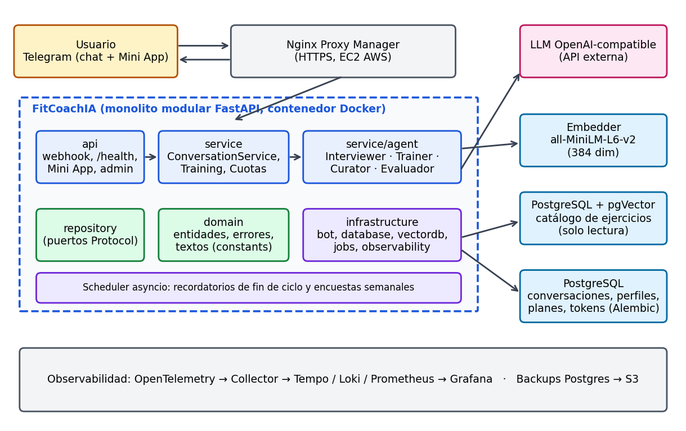
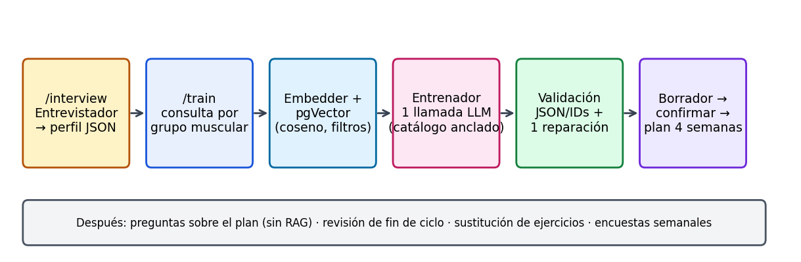
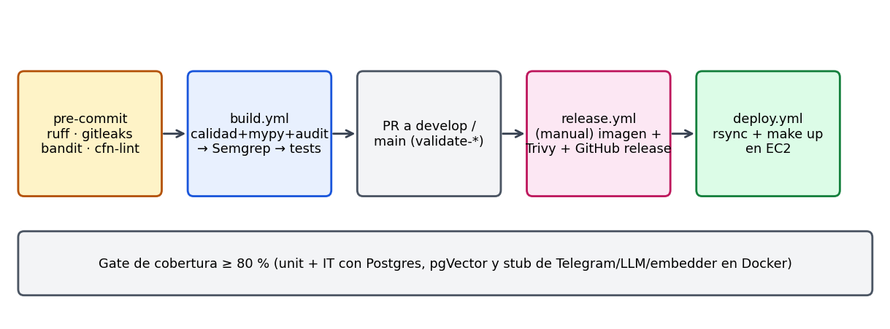

> **Borrador para revisión.** Los textos marcados como **[POR COMPLETAR]** requieren datos que no
> figuran en el repositorio (roles confirmados por el equipo, cifras de mercado con fuente y
> mediciones reales de producción). No se han inventado cifras.

# 1. Introducción y resumen ejecutivo

**FitCoach IA** es un entrenador personal inteligente que funciona dentro de **Telegram**. A partir de
una entrevista conversacional genera un **mesociclo personalizado de 4 semanas**, responde dudas sobre
el plan, lo revisa al terminar el ciclo y propone el siguiente bloque. La solución combina IA
Generativa (LLM) con **RAG** sobre un catálogo de ejercicios en una base de datos vectorial, de modo
que el plan solo contiene ejercicios reales y verificables del catálogo.

**Problema.** Los planes de entrenamiento personalizados requieren un profesional, son caros y se
quedan obsoletos en cuanto cambian las circunstancias del cliente. Las apps genéricas ofrecen rutinas
estáticas, y un LLM «a pelo» inventa ejercicios, ignora lesiones o material disponible y no mantiene
continuidad.

**Solución.** Una arquitectura multiagente con validación determinista alrededor del modelo:

- **Entrevistador**: conduce la entrevista y produce un perfil JSON validado con Pydantic.
- **Entrenador**: genera el plan con una llamada al LLM anclada al catálogo recuperado por RAG,
  valida la salida (IDs, material, días, duplicados) y permite una única reparación.
- **Curador de ejercicios**: evalúa propuestas de nuevos ejercicios de los usuarios antes de la
  moderación humana.
- Servicios operativos: cuotas de consumo, encuestas semanales de satisfacción, Mini App de Telegram
  para registrar sesiones, panel de administración y observabilidad completa.

**Resultados principales.**

| Indicador | Resultado |
|---|---|
| Desarrollo | 383 commits entre el 04/03/2026 y el 25/10/2026; 4 autores |
| Calidad | 837 funciones de test (unitarias e integración); gate de cobertura ≥ 80 % |
| Entrega | Pipeline CI/CD completo (calidad, SAST, tests, Trivy, release y despliegue automático) |
| Despliegue | Una EC2 en AWS con CloudFormation, Nginx Proxy Manager y backups a S3 |
| Observabilidad | 5 dashboards de Grafana (negocio, entrevistas, Telegram, agentes/LLM, RAG) |
| Coste controlado | Cuota por chat y registro de tokens/coste por llamada |

Alcance real al cierre: los agentes **Entrevistador** y **Entrenador** están implementados y en uso.
Los agentes **Nutricionista** y **Coaching** previstos en la visión original están reservados en el
código (`AgentType`) pero no implementados; se tratan como trabajo futuro (apartado 9).

# 2. Descripción detallada del caso de negocio

## 2.1 Oportunidad identificada

- **Barrera de acceso**: un entrenador personal supone un coste mensual elevado; la mayoría de
  practicantes recreativos entrena sin plan o con plantillas genéricas.
- **Falta de continuidad**: los planes se entregan una vez y no se adaptan al progreso, a las
  molestias ni a los cambios de horario o material.
- **Fricción de las apps**: instalar y aprender una aplicación más reduce la adherencia. Telegram ya
  está en el bolsillo del usuario y permite botones, encuestas y Mini Apps.
- **Madurez tecnológica**: los LLM permiten entrevistar en lenguaje natural y los embeddings
  permiten anclar sus respuestas a una fuente fiable.

## 2.2 Análisis de mercado

| Segmento | Alternativas actuales | Limitación frente a FitCoach IA |
|---|---|---|
| Entrenador personal humano | Alta personalización y seguimiento | Coste alto, disponibilidad limitada, no escala |
| Apps de rutinas (plantillas) | Bajo coste, catálogos amplios | Rutinas estáticas, sin entrevista ni renovación adaptada |
| Chatbots LLM genéricos | Conversación flexible | Alucinan ejercicios, no persisten el plan, sin controles de seguridad |
| Wearables / apps de seguimiento | Datos objetivos | Registran, pero no diseñan el entrenamiento |

**[POR COMPLETAR]** Tamaño del mercado (fitness digital / personal training online), crecimiento y
adopción de Telegram en el público objetivo, con fuentes citadas (informes sectoriales, Statista,
etc.). Competidores concretos a nombrar y comparar (precio, canal, personalización).

**Público objetivo**: practicantes recreativos que quieren un plan estructurado y adaptable sin pagar
un entrenador, cómodos con la mensajería instantánea.

## 2.3 Justificación de la solución

1. **Personalización a escala con coste marginal bajo**: una entrevista completa consume del orden
   de 50.000 tokens; con el modelo configurado por defecto, el coste de un chat que agota su cuota
   diaria se estimó en ~0,45 $/mes (documento `docs/rate-limiter.md`).
2. **Fiabilidad por diseño**: el plan solo puede contener ejercicios del catálogo (RAG + validación),
   respeta lesiones y material declarados y ante señales de riesgo se mantiene conservador y
   recomienda atención profesional. El sistema no diagnostica ni sustituye a profesionales sanitarios.
3. **Ciclo cerrado**: entrevista → plan → seguimiento → revisión → nuevo plan, con encuestas
   semanales que alimentan métricas de negocio.
4. **Canal sin fricción**: Telegram (chat, botones inline, encuestas y Mini App).

**Modelo de negocio y métricas de éxito**: activación (entrevistas completadas, perfiles con plan),
adopción de agentes, satisfacción del plan (encuesta semanal) y coste por usuario activado; todas
están definidas e implementadas en dashboards (apartado 8). **[POR COMPLETAR]** Modelo de ingresos
(freemium/suscripción) si el equipo lo define.

# 3. Contribución individual

Datos obtenidos del historial de Git (identidades unificadas) y de `docs/AUTHORS.md`.
**[POR COMPLETAR]** Cada miembro debe validar y ampliar su fila: la evaluación es individualizada y
los commits no reflejan toda la aportación (diseño, revisión, pruebas manuales, gestión).

| Miembro | Commits aprox. | Responsabilidades (evidencia en el repositorio) |
|---|---|---|
| **Sergio Soriano San José** | ~190 | Núcleo de la aplicación y agentes: ciclo de vida del mesociclo, adaptación y revisión, sustituciones guiadas por botones, cuotas y panel de administración, contribuciones al catálogo con curador IA, scheduler de recordatorios y encuestas, Mini App, observabilidad (OpenTelemetry, dashboards, precios de modelos), herramientas offline (`trainer-debug`/`trainer-compare`), `rag-doc` (preguntas a la documentación por texto y voz), entornos dev/prod y documentación |
| **Raúl Sánchez Serrano** | ~165 | Estructura inicial del proyecto, Makefile y Dockerfile, skill del entrenador personal, workflows de GitHub Actions (build, release, validación de ramas), actions compuestas, Semgrep/Bandit, timeouts del entrenador, mocks de Telegram para tests, métricas Prometheus |
| **Angel Pérez Izquierdo** | ~39 | Base de datos vectorial (imagen pgVector precargada y cargador de datos), primera implementación de RAG y del agente Entrenador, composes dev/prod de la BD vectorial, correcciones de reintentos ante respuestas inválidas del LLM, despliegue en una única EC2 (plantilla CloudFormation, Session Manager, producción) y su documentación |
| **Juan Martínez Fraile** | ~3 | **[POR COMPLETAR]** — el historial solo refleja aportaciones menores (perfil en `AUTHORS.md`) |

Nota: además existen 10 commits del agente `copilot-swe-agent`, no atribuibles a ningún miembro.

# 4. Arquitectura técnica de la solución

## 4.1 Visión general

Monolito modular **FastAPI** con estructura por capas y puertos/adaptadores. Regla de dependencias:
`api → service → domain ← repository (puertos) ← infrastructure (adaptadores)`; `main.py` es la raíz
de composición y valida **todas** las configuraciones al arrancar (fail-fast).

{width=16cm}

## 4.2 Componentes

| Componente | Responsabilidad |
|---|---|
| `api/` | Solo HTTP: webhook de Telegram (403 sin cabecera secreta, 400 si el update está mal formado; tras un update válido y autenticado siempre devuelve `{"ok": true}` para evitar reintentos), `/health`, Mini App y panel admin |
| `service/` | Casos de uso: `ConversationService` enruta comandos (`/start`, `/interview`, `/train`, `/doubts`, `/progress`), entrenamiento, cuotas |
| `service/agent/` | Cadenas LLM: `BaseLLMChain`, entrevistador, entrenador, adaptación, curador, evaluador determinista, recuperador RAG |
| `domain/` | Entidades Pydantic, errores y todos los textos de usuario (`constants.py`); sin I/O |
| `repository/` | Puertos `Protocol` (conversación, ejercicios, entrenamiento, evaluación, jobs) |
| `infrastructure/` | Adaptadores: bot de Telegram, SQLAlchemy async, pgVector (solo lectura), cliente de embeddings, scheduler, OpenTelemetry |
| Embedder | Servicio independiente con `all-MiniLM-L6-v2` (384 dimensiones) |
| PostgreSQL conversacional | Mensajes, perfiles, planes, uso de tokens, cuotas; migraciones con **Alembic** |
| PostgreSQL + pgVector | Catálogo de ejercicios, servidor y rol de solo lectura distintos |
| Observabilidad | OTel Collector, Tempo, Loki, Prometheus y Grafana |

## 4.3 Justificación tecnológica

| Decisión | Motivo |
|---|---|
| FastAPI + asyncio | Webhook de baja latencia, I/O concurrente (LLM, BD, Telegram) y tipado con Pydantic v2 |
| Monolito modular, no microservicios | Equipo de 4 personas y una sola EC2; los límites entre capas permiten extraer servicios más adelante |
| Puertos y adaptadores | Tests unitarios sin red, y proveedor/BD sustituibles |
| API OpenAI-compatible vía `langchain-openai` | Proveedor intercambiable (OpenAI, OpenRouter, modelo local) cambiando `ia_base_url`/`ia_model` |
| pgVector en PostgreSQL | Un único motor conocido, filtros SQL obligatorios (material, objetivo) combinados con distancia coseno; evita añadir una base vectorial dedicada |
| Embedder propio (all-MiniLM-L6-v2) | Embeddings locales y gratuitos, sin enviar datos del catálogo a terceros; **debe coincidir** con el modelo del corpus |
| Telegram | Canal sin instalación, botones, encuestas y Mini App |
| Alembic | Esquema versionado y migraciones compatibles hacia atrás |
| Docker + Compose | Portabilidad; la imagen se construye en el servidor y el rollback es redesplegar la versión anterior |
| AWS EC2 única + CloudFormation + S3 | Coste mínimo para un MVP, infraestructura como código, backups fuera de la máquina |
| OpenTelemetry + Grafana stack | Estándar abierto y trazabilidad de latencia, tokens y errores |

## 4.4 Despliegue y seguridad

Una EC2 ejecuta la aplicación, el embedder, las dos bases de datos y Nginx Proxy Manager (TLS y
dominio). El acceso del equipo es por Session Manager. Medidas de seguridad: cabecera secreta del
webhook de Telegram, rol de solo lectura para el catálogo y rol limitado de escritura solo para
ejercicios aprobados, usuario no root en el contenedor, cuotas de consumo, callbacks con identidad
y revisión del flujo, autorización de la Mini App y secretos fuera del repositorio (`gitleaks`).

# 5. Diseño y desarrollo de la solución de IA

## 5.1 Núcleo del MVP: flujo multiagente con RAG

{width=16cm}

**Agente Entrevistador.** Conversación estructurada con reglas de seguridad y contrato JSON de salida.
Devuelve un `InterviewerProfile` validado por Pydantic; ante JSON inválido hace una reparación y,
si falla, un error controlado. Mantiene historial propio separado por agente.

**Agente Entrenador.**

1. **Recuperación**: una consulta por grupo muscular (derivado del `target` anatómico) con el
   material declarado; se vectoriza en el embedder y se busca en pgVector por distancia coseno con
   filtros obligatorios. Los resultados se fusionan y deduplican en un contexto `{{rag_context}}`.
2. **Generación**: una llamada al LLM con el prompt de sistema (skill del método de entrenamiento +
   catálogo) y el perfil.
3. **Validación determinista**: JSON, IDs y nombres canónicos del catálogo, material confirmado,
   objetivo, entorno, días y duración frente al perfil, y ausencia de duplicados en una sesión.
   Si falla, **una única reparación**.
4. **Borrador → confirmación**: el plan es un borrador no activo hasta que el usuario lo acepta
   (botones inline); la confirmación es idempotente y comprueba revisión y propietario.

**Funciones adicionales del entrenador**

- *Preguntas sobre el plan*: modo de solo lectura sin RAG; el plan guardado prevalece sobre el
  historial.
- *Sustitución de ejercicio*: detección de intención en lenguaje natural, selector por botones,
  alternativas del mismo `target` y confirmación explícita (el modelo nunca modifica por sí solo).
- *Revisión y renovación*: al terminar el ciclo, un extractor estructura adherencia, resultados,
  recuperación, molestias y preferencias; los síntomas preocupantes bloquean la generación. El nuevo
  bloque conserva lo útil y progresa gradualmente sin inventar cargas.
- *Seguimiento*: Mini App para registrar series y sesiones sin consumir LLM.

**Agente Curador.** Evalúa propuestas de nuevos ejercicios con salida estructurada estricta y detector
de duplicados; solo los aprobados por un moderador se publican, de forma idempotente, en pgVector.

**Evaluador determinista de planes** (`plan_evaluator`): reglas sin LLM sobre volumen, periodización,
esfuerzo, repeticiones, descansos, cobertura muscular y lesiones; se usa en devtools y casos de oro
para comparar skills y modelos.

## 5.2 Medidas de fiabilidad y control

- **Anclaje al catálogo** (RAG + validación) para evitar ejercicios inventados.
- **Salida estructurada** con una reparación y errores del proveedor mapeados a códigos propios.
- **Memoria acotada**: historial por agente y ventana configurable; el reinicio con `/interview`
  borra planes e historial previos.
- **Cuotas por chat**: valores calculados a partir del coste medido (p. ej. límite de 150.000 tokens
  en ventana de 24 h, umbral blando 0,66 para no permitir iniciar una entrevista que no se podría
  terminar).
- **Seguridad clínica**: no diagnostica; banderas rojas mantienen el plan conservador.
- **Degradación**: si la recuperación falla o el catálogo queda vacío, no se amplían restricciones
  para «rellenar»; el usuario recibe un fallback controlado y el webhook nunca propaga excepciones.

## 5.3 Ingeniería de prompts

Cada agente se compone en `agent_factory` desde `prompts/<agente>/system_prompt.txt` y
`ia/skills/<agente>/SKILL.md` (conocimiento experto; variantes `-dev` más ligeras). Hay prompts
distintos para generación, consulta, extracción de revisión y sustitución, cada uno con su modelo,
temperatura y presupuesto de tokens configurables.

# 6. Proceso de IA (entrenamiento / modelos)

**No se ha realizado entrenamiento ni fine-tuning.** Se utilizan **modelos preentrenados vía API**
y un modelo de embeddings local, y el esfuerzo se concentra en ingeniería de prompts, RAG, validación
y evaluación.

| Elemento | Modelo / enfoque | Configuración |
|---|---|---|
| LLM conversacional y de planes | Cualquier API OpenAI-compatible (ejemplo por defecto en `.env.example`: `gpt-5-nano-2025-08-07`) | `ia_base_url`, `ia_model`, `ia_temperature` |
| Modelos por tarea del entrenador | Generación, consulta y extracción con modelo, temperatura, `max_tokens` y timeout independientes | `ia_trainer_*` |
| Curador de ejercicios | `gpt-5.4-mini` por defecto, temperatura 0,1 | `ia_exercise_curator_*` |
| Razonamiento del entrevistador | `minimal` por defecto; `default` omite el parámetro para proveedores incompatibles | `ia_interviewer_reasoning_effort` |
| Embeddings | `all-MiniLM-L6-v2`, 384 dimensiones, servicio propio | `embedder_*` |
| Transcripción/voz (solo `rag-doc`) | faster-whisper y Piper locales | `infra/rag-doc` |

**Corpus del catálogo**: se carga desde scripts SQL numerados (`infra/vector-db/ddl/`) con los
embeddings ya calculados; los ejercicios aprobados por la comunidad se vectorizan de forma
incremental con el mismo modelo.

**Selección y comparación de modelos**: las devtools (`trainer-debug`, `trainer-compare`) permiten
renderizar prompts sin coste, reproducir el caso real de un usuario y comparar skills y modelos con
el evaluador determinista. No hay *fallback* silencioso a otro modelo: las llamadas fallidas y las
reparaciones conservan modelo y tokens en `token_usage`.

**Nota**: la visión inicial mencionaba redes neuronales para optimizar rutinas con datos históricos;
no está implementada y se plantea como trabajo futuro cuando haya datos suficientes.

# 7. Integración con herramientas DevOps

## 7.1 Pipeline CI/CD

{width=16cm}

| Fase | Herramientas |
|---|---|
| Local (shift-left) | pre-commit: higiene, `gitleaks`, `ruff` + `ruff-format`, `bandit`, `cfn-lint`; bloqueo de commits directos a `main`/`develop` |
| CI (`build.yml`) | Calidad y seguridad (ruff, mypy estricto, gitleaks, pip-audit, bandit) → Semgrep (SAST) → tests con cobertura mínima del 80 % |
| Control de ramas | `validate-develop-merge` y `validate-main-merge`; flujo `feature/* → develop → main` |
| Release (`release.yml`) | Manual y versionado; construye la imagen, escaneo Trivy (SARIF en la pestaña Security) y crea la release de GitHub |
| Deploy (`deploy.yml`) | Sincroniza el tag en el servidor y ejecuta `make up`; la imagen se construye allí; rollback = redesplegar la versión anterior |

El `Makefile` es el punto de entrada común para desarrollo local y CI, sin duplicar lógica en YAML.
Las dependencias tienen fuente única (`pyproject.toml`) y los ficheros de requisitos se generan con
`uv pip compile`.

## 7.2 Pruebas

- **Unitarias** (`tests/unit_test`): sin red ni Docker, repositorios y chains simulados.
- **Integración** (`tests/it`): FastAPI con *lifespan* real contra contenedores de Postgres y
  pgVector y un **servidor stub** que simula Telegram, LLM y embedder.
- Cada nivel cubre casos **OK y KO**; casos de oro del entrenador y pruebas de migraciones, jobs,
  cuotas, Mini App y dashboards.
- 837 funciones de test; cobertura mínima exigida del 80 % en `src/fitcoach` (`make tests`).

## 7.3 Versionado y documentación

- Ramas con protección, *Conventional Commits* y versiones etiquetadas (`git tag`) con release de
  GitHub; migraciones Alembic compatibles hacia atrás.
- Documentación técnica en `docs/` (Markdown en español) mantenida junto al código: agentes, RAG,
  modelo de datos, scheduler, CI/CD, Makefile, despliegue AWS (con diagrama), observabilidad,
  tests. `AGENTS.md` actúa como mapa del proyecto para asistentes de IA y define una checklist que
  obliga a actualizar docs y tests en cada cambio. Además, `infra/rag-doc` ofrece una PWA para
  consultar la documentación por texto o voz.

## 7.4 Monitorización

Trazas OpenTelemetry, logs JSON estructurados y una fila `token_usage` por llamada LLM (tokens,
coste, latencia, estado). Stack Grafana/Loki/Tempo/Prometheus con cinco dashboards provisionados
(negocio, entrevistas, Telegram y backend, agentes y LLM, RAG y catálogo), filtro dev/prod y
semántica explícita de lo que cada métrica no mide (por ejemplo, no se inventan datos cuando un
denominador es cero).

# 8. Evaluación de la solución

## 8.1 Métricas técnicas

| Métrica | Fuente | Estado |
|---|---|---|
| Latencia p50/p95 de llamadas LLM, tokens y coste conocido por agente/modelo | `token_usage` (dashboard Agentes) | Implementada — **[POR COMPLETAR]** valores medidos en producción |
| Errores LLM (`status ≠ success`, `llm_invalid_output`, `llm_output_limit`) | `token_usage` | Implementada |
| Latencia de fases del entrenador (recuperación, generación) | Logs `training_latency` | Implementada (anidadas; sus percentiles no se suman) |
| Fallos de RAG y contexto aportado frente a utilizado | Logs y trazas de planes | Implementada con cobertura documentada |
| Latencia de recuperación p95 (incluye embeddings) | Logs `phase=retrieval` | Proxy implementado |
| Cobertura de tests y calidad estática | CI | ≥ 80 %, ruff, mypy estricto, bandit, Semgrep, Trivy |
| Latencia por turno completo, similitud top-1 | — | Pendiente de instrumentar (no se estiman) |

Evaluación de la calidad del plan: el **evaluador determinista** y los casos de oro comprueban que el
plan respeta catálogo, volumen, descansos, lesiones y cobertura muscular, y permiten comparar
modelos y skills sin juicio subjetivo.

## 8.2 Métricas funcionales (objetivos de negocio)

| Objetivo | Métrica |
|---|---|
| Activación | Entrevistas completadas (N1) y perfiles con plan (N2) |
| Adopción | Agentes distintos usados por usuario (N3) |
| Satisfacción | Encuesta semanal en Telegram: media por cliente, tasa sin contestar y encuestas no generadas (N4) |
| Eficiencia económica | Coste LLM por usuario activado (N5b); cuota por chat acotando el peor caso |
| Calidad de la entrevista | Interacciones y tiempo por entrevista, reinicios (E2–E4) |

**[POR COMPLETAR]** Resultados reales: nº de usuarios/pruebas, porcentaje de entrevistas completadas,
satisfacción media, coste por usuario y latencias p50/p95 obtenidas de los dashboards. Pendientes de
implementar por falta de datos persistidos: coste por plan, sentimiento y similitud de recuperación.

## 8.3 Limitaciones conocidas

Los registros de sesiones y resultados son autodeclarados; las métricas basadas en logs tienen
retención de 14 días; confirmar un borrador no equivale a satisfacción; el catálogo condiciona la
variedad de los planes.

# 9. Conclusiones finales y trabajo futuro

## 9.1 Conclusiones

- Un MVP de IA Generativa útil exige **ingeniería alrededor del modelo**: RAG, validación,
  confirmación humana, cuotas y observabilidad pesan tanto como el prompt.
- Anclar el plan al catálogo y validar la salida elimina la principal fuente de error de un LLM
  genérico (ejercicios inventados) a un coste por usuario muy bajo.
- La disciplina DevOps (pre-commit, CI con gates, IaC, despliegue automático, documentación como
  código) permitió que un equipo de cuatro personas iterara con seguridad durante ocho meses.
- Los modelos preentrenados mediante API fueron suficientes; la calidad se gestiona con prompts,
  evaluación determinista y comparación de modelos, no con entrenamiento.

## 9.2 Trabajo futuro

1. **Agente Nutricionista** (alimentación y suplementación) y **Agente Coaching** (motivación y
   recursos), ya reservados en la arquitectura.
2. **Optimización con datos históricos** (modelos de ML sobre adherencia y progreso) cuando exista
   volumen suficiente.
3. **Métricas pendientes**: latencia por turno, coste por plan, similitud de recuperación,
   sentimiento.
4. **Ampliación del catálogo** mediante el flujo de contribuciones moderadas por IA y humanos.
5. **Escalado**: separar servicios, alta disponibilidad y bases de datos gestionadas más allá de la
   EC2 única; integración con wearables; modelos locales para reducir coste y dependencia.
6. **Producto**: modelo de monetización, más idiomas y un panel web para el usuario final.
